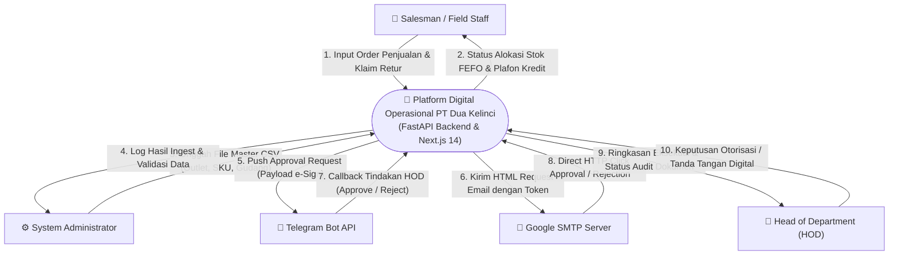
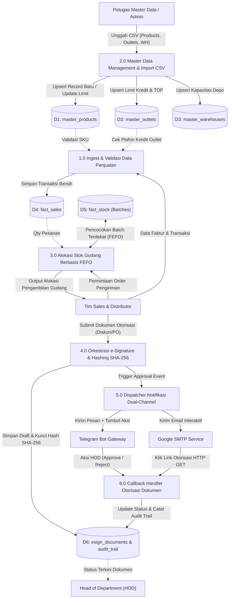

# PT Dua Kelinci - Digital Operations Platform & Executive Analytics

Platform digital operasional terpadu PT Dua Kelinci yang mengintegrasikan analitik penjualan komprehensif, eksekusi e-Signature HOD dual-channel (Telegram Bot & Email SMTP), alokasi persediaan gudang berbasis FEFO (First Expired First Out), serta Master Data Management (MDM) dengan kemampuan import/upsert CSV secara instan.

---

## 📑 Daftar Isi
1. [Fitur Utama Sistem](#1-fitur-utama-sistem)
2. [Arsitektur Data Flow Diagram (DFD)](#2-arsitektur-data-flow-diagram-dfd)
   - [DFD Level 0 (Context Diagram)](#dfd-level-0-context-diagram)
   - [DFD Level 1 (Proses Operasional Utama)](#dfd-level-1-proses-operasional-utama)
3. [Entity Relationship Diagram (ERD)](#3-entity-relationship-diagram-erd)
4. [Master Data Management & CSV Import](#4-master-data-management--csv-import)
5. [e-Signature HOD Dual-Channel Workflow](#5-e-signature-hod-dual-channel-workflow)
6. [Panduan Menjalankan dengan Docker](#6-panduan-menjalankan-dengan-docker)
7. [Dokumentasi Lengkap Monorepo](#7-dokumentasi-lengkap-monorepo)

---

## 1. Fitur Utama Sistem

* **Executive Analytics Dashboard:**
  * Analisis 1.891 baris transaksi riil (September – Oktober 2026) senilai Rp 84,7 Miliar.
  * Breakdown 6 region (Jawa Barat, Jawa Tengah, Jawa Timur, DKI Jakarta, Sumatera Bagian Utara, Kalimantan Barat).
  * Distribusi 8 brand unggulan (*Kacang Sukro, Deka Wafer, TicTac, Fuzo, Usagi Puff, Sanghai, Koro, Mix Nuts*).
  * Deteksi otomatis *Top/Bottom 5 Outlets* dan anomali margin/diskon.
* **Master Data Management (MDM):**
  * Manajemen data Outlet (51 outlet), SKU Produk (13 SKU), Gudang/Depo (13 depo cabang), dan **Karyawan Terpadu (16 profil personil Sales & Warehouse)**.
  * Fitur **Edit Modal** dan **Delete Data** interaktif untuk seluruh master entitas (Karyawan, Outlet, SKU Produk, Gudang).
  * Pengubahan limit kredit outlet secara realtime dengan verifikasi proteksi piutang.
  * **Import CSV Fleksibel:** Kemampuan upload file CSV untuk upsert master karyawan, outlet, SKU, dan gudang sekaligus.
* **Dual Persona Architecture (Sales & Warehouse):**
  * **Persona Sales:** Terintegrasi untuk *Head of Sales*, *Regional Sales Manager (Jabar, Jatim, Jabodetabek)*, *Area Supervisor*, hingga *Field Salesman*. Menyajikan analitik realisasi target omzet, anomali diskon, top/bottom outlet, serta pembuatan persetujuan diskon komersial.
  * **Persona Warehouse & Logistik:** Terintegrasi untuk *Head of Warehouse*, *Regional Warehouse Manager (Bandung, Surabaya, Semarang)*, *Supervisor*, *FEFO Picking Lead*, hingga *Inspector*. Menyajikan monitor kapasitas gudang, alokasi batch stok terdekat (FEFO), serta otorisasi dokumen logistik & transfer depo.
* **Dual-Channel e-Signature HOD:**
  * Otorisasi dokumen operasional (Diskon Khusus, PO Logistik, Realokasi Stok) oleh HOD (Sales, Marketing, Finance, Warehouse).
  * Pengiriman notifikasi interaktif via **Telegram Bot** (`@mwyzer` / Chat ID `6190060235`) dengan tombol inline action.
  * Pengiriman notifikasi email via **Google SMTP SSL (Port 465)** dengan tombol aksi direct approval satu klik (`APPROVE` / `REJECT`).
  * Audit trail lengkap berbasis hashing kriptografis SHA-256.
* **WMS FEFO Stock Allocator:**
  * Algoritma alokasi stok batch gudang otomatis memprioritaskan tanggal kedaluwarsa terdekat untuk meminimalkan *write-off* barang rusak.
* **Modern Vertical Sidebar Layout:**
  * Navigasi desktop modern yang intuitif membagi modul: Dashboard Eksekutif, Master Data, e-Signature HOD, WMS FEFO, dan Telegram Brief.

---

## 2. Arsitektur Data Flow Diagram (DFD)

### DFD Level 0 (Context Diagram)
Diagram konteks menggambarkan interaksi batas sistem Platform Operasional PT Dua Kelinci dengan entitas luar (Salesman, HOD Manager, Administrator, Telegram API, dan Google Mail Server).



---

### DFD Level 1 (Proses Operasional Utama)
Diagram Level 1 merinci sub-proses di dalam platform: Pengolahan Penjualan, Master Data Upsert, Mesin e-Sign, Alokasi FEFO Gudang, dan Notifikasi Telegram/Email.



---

## 3. Entity Relationship Diagram (ERD)

Struktur relasi basis data operasional terpadu menggabungkan data warehouse analitik penjualan, master data operasional, dan tabel e-Signature yang saling terintegrasi:

```mermaid
erDiagram
    MASTER_PRODUCTS ||--o{ FACT_SALES : "sku = sku_id"
    MASTER_PRODUCTS ||--o{ FACT_STOCK : "sku = sku_id"
    MASTER_OUTLETS ||--o{ FACT_SALES : "outlet_id = outlet_id"
    MASTER_WAREHOUSES ||--o{ FACT_STOCK : "warehouse_id = warehouse_id"
    MASTER_WAREHOUSES ||--o{ MASTER_EMPLOYEES : "warehouse_id = warehouse_id"
    
    ESIGN_DOCUMENTS ||--o{ ESIGN_SIGNERS : "id = doc_id"
    ESIGN_DOCUMENTS ||--o{ ESIGN_AUDIT_TRAIL : "id = doc_id"

    MASTER_EMPLOYEES {
        int id PK "Auto Increment Employee ID"
        string employee_id UK "Nomor Induk Karyawan (NIP)"
        string full_name "Nama Lengkap Karyawan"
        string email UK "Alamat Email Korporat"
        string phone "Nomor Telepon / WhatsApp"
        string department "Divisi (SALES / WAREHOUSE)"
        string job_title "Jabatan Resmi Operasional"
        string role_type "Tingkatan (MANAGER / SUPERVISOR / STAFF)"
        string region "Wilayah Kerja (Nasional / Jabar / Jatim / dll)"
        string branch "Cabang Operasional"
        string warehouse_id FK "Relasi ke Gudang (Khusus Warehouse)"
        string status "ACTIVE / INACTIVE"
    }

    MASTER_PRODUCTS {
        string sku_id PK "Kode SKU Produk"
        string sku_name "Nama Lengkap SKU"
        string brand "Kategori Brand (Sukro, Deka, TicTac, dll)"
        string category "Kategori Makanan Ringan"
        int carton_pack_qty "Isi per Karton (Default: 24)"
        real price_het_idr "Harga Eceran Tertinggi (HET)"
        real price_wholesale_idr "Harga Grosir / Distributor"
        int shelf_life_days "Masa Simpan (Hari)"
        string status "ACTIVE / INACTIVE"
    }

    MASTER_OUTLETS {
        string outlet_id PK "Kode Unik Outlet"
        string outlet_name "Nama Toko / Distributor"
        string outlet_type "Tipe Outlet (Grosir / Retail / MT)"
        string region "Wilayah Penjualan"
        string branch "Cabang Depo"
        real credit_limit_idr "Plafon Kredit Maksimal (IDR)"
        int payment_term_days "Term of Payment (TOP Hari)"
        string status "ACTIVE / BLOCKED"
    }

    MASTER_WAREHOUSES {
        string warehouse_id PK "Kode Depo Gudang"
        string warehouse_name "Nama Gudang Cabang"
        string region "Wilayah Regional"
        string branch "Kota Cabang"
        int capacity_carton "Kapasitas Maksimal Karton"
        string status "ACTIVE / MAINTENANCE"
    }

    FACT_SALES {
        bigint id PK "Auto Increment ID"
        date date "Tanggal Transaksi Penjualan"
        string invoice_no "Nomor Faktur / Faktur Pajak"
        string transaction_type "SALE atau RETURN"
        string region "Wilayah Transaksi"
        string branch "Cabang Transaksi"
        string outlet_id FK "Kode Outlet Terdaftar"
        string salesman_id "Kode Salesman Pengampu"
        string brand "Nama Brand"
        string sku FK "Kode SKU Produk Terjual"
        int qty_carton "Jumlah Karton"
        real price_per_carton_idr "Harga Satuan per Karton"
        real gross_sales_idr "Nilai Penjualan Kotor"
        real discount_idr "Nilai Diskon Promosi"
        real net_sales_idr "Penjualan Bersih (Gross - Diskon)"
    }

    FACT_STOCK {
        bigint id PK "Batch Stock ID"
        string warehouse_id FK "Kode Gudang Penyimpanan"
        string sku FK "Kode SKU Barang"
        string batch_no "Nomor Batch Produksi"
        date expiry_date "Tanggal Kedaluwarsa (Kunci FEFO)"
        int qty_on_hand_carton "Stok Fisik Tersedia"
        int qty_reserved_carton "Stok Telah Dipesan"
        real cost_per_carton_idr "Harga Pokok Produksi per Karton"
    }

    ESIGN_DOCUMENTS {
        string id PK "UUID Dokumen Otorisasi"
        string title "Judul Dokumen / Proposal"
        string department "Departemen Pemohon"
        string doc_type "DISCOUNT_PROMO / PO_LOGISTICS / STOCK_TRANSFER"
        string file_name "Nama File PDF Asli"
        real amount_idr "Nilai Finansial yang Diajukan"
        string sha256_hash "Hash Integritas Kriptografis SHA-256"
        string status "IN_PROGRESS / COMPLETED / REJECTED"
        int current_step "Urutan Persetujuan Aktif"
        int total_steps "Total Langkah Otorisasi"
        string created_by "Nama Inisiator"
        string created_at "Waktu Pengajuan (ISO UTC/WIB)"
        string completed_at "Waktu Penyelesaian Otorisasi"
    }

    ESIGN_SIGNERS {
        int id PK "Auto Increment Signer ID"
        string doc_id FK "Relasi ke Dokumen"
        string signer_email "Email Pejabat HOD"
        string signer_name "Nama Lengkap Penandatangan"
        string department "Departemen HOD"
        string role_title "Jabatan Resmi Penandatangan"
        int step_order "Urutan Hirarki Penandatanganan"
        string status "PENDING / CURRENT / SIGNED / REJECTED"
        string signed_at "Waktu Persetujuan Diberikan"
        string ip_address "Alamat IP Penandatangan"
        string rejection_reason "Catatan Alasan jika Ditolak"
    }

    ESIGN_AUDIT_TRAIL {
        int id PK "Auto Increment Log ID"
        string doc_id FK "Relasi Dokumen Terkait"
        string action "CREATED / REQUESTED / SIGNED / REJECTED"
        string actor_name "Nama Pelaku Tindakan"
        string details "Rincian Teknis & Payload Event"
        string timestamp "Waktu Audit Terjadi"
    }
```



---

## 4. Master Data Management & CSV Import

Sistem dilengkapi antarmuka Master Data terintegrasi dengan kemampuan:
1. **Pencarian & Filter Cepat:** Mencari outlet, produk, atau gudang secara instan berdasarkan nama, kode, atau cabang.
2. **Pembaruan Kredit Limit Interaktif:** Mengubah limit kredit outlet langsung dari antarmuka tabel dengan verifikasi instan.
3. **Import File CSV:** 
   * Endpoint: `POST /api/v1/master/import-csv`
   * Format header yang didukung:
     * **Outlets:** `outlet_id, outlet_name, outlet_type, region, branch, credit_limit_idr, payment_term_days`
     * **Products:** `sku_id, sku_name, brand, category, carton_pack_qty, price_het_idr, price_wholesale_idr, shelf_life_days`
     * **Warehouses:** `warehouse_id, warehouse_name, region, branch, capacity_carton`
     * **Employees:** `employee_id, full_name, email, phone, department, job_title, role_type, region, branch, warehouse_id`
   * Sistem mendeteksi jenis entity secara cerdas berdasarkan kecocokan kolom dan melakukan operasi **UPSERT** (*insert or replace*).

---

## 5. e-Signature HOD Dual-Channel Workflow

Sistem persetujuan berjenjang mendukung otorisasi lintas departemen (Sales, Marketing, Finance, Warehouse):

1. **Inisiasi & Hashing:** Dokumen diunggah, nilai transaksi diekstrak, dan hash dokumen SHA-256 dibuat untuk segel anti-manipulasi.
2. **Multi-Channel Dispatch:**
   * **Telegram Bot:** Mengirim pesan format Markdown ke HOD dengan tombol inline persetujuan.
   * **Google SMTP SSL:** Mengirim email desain profesional responsif dengan tombol tombol aksi direct callback.
3. **Callback Aksi:** Saat HOD menekan **Setujui** atau **Tolak**, sistem mencatat IP address, stempel waktu WIB, dan memajukan dokumen ke penandatangan berikutnya hingga status mencapai `COMPLETED`.

---

## 6. Panduan Menjalankan dengan Docker

Platform telah terintegrasi penuh menggunakan **Docker Compose** dengan 3 layanan utama:
1. **`postgres` (PostgreSQL 16 Alpine):** Database relasional enterprise yang menyimpan seluruh tabel fakta analitik penjualan, batch stok gudang, user scope, dan master data, otomatis terisi melalui script inisialisasi `init-duakelinci.sql`.
2. **`backend` (FastAPI Python 3.12):** REST API dengan dukungan otomatis PostgreSQL (dan fallback SQLite lokal) serta healthcheck terintegrasi.
3. **`frontend` (Next.js 14 Standalone):** Dashboard analitik interaktif modern dengan Vertical Sidebar Navigation.

### Prasyarat:
- Docker Desktop / Docker Engine 24+
- Docker Compose v2+

### Menjalankan Container:
```bash
# 1. Clone repository
git clone <repository_url>
cd Kacang

# 2. Build dan jalankan seluruh container (PostgreSQL, Backend & Frontend)
docker compose up -d --build

# 3. Cek status container yang berjalan
docker compose ps
```

### Konfigurasi Database PostgreSQL:
- **Host:** `127.0.0.1` (atau `postgres` di dalam network docker)
- **Port:** `5432`
- **Database:** `duakelinci_dwh`
- **User:** `duakelinci_user`
- **Password:** diambil dari `POSTGRES_PASSWORD` di `.env` (salin dari `.env.example`, jangan di-commit)
- **Volume Data Persisten:** `postgres_data`
- **Inisialisasi Otomatis:** `docker/postgres/init-duakelinci.sql`

### Mengakses Layanan:
- **Frontend Dashboard (Next.js 14):** `http://localhost:3000`
- **Backend REST API (FastAPI):** `http://localhost:8000`
- **Dokumentasi Interaktif API (Swagger UI):** `http://localhost:8000/docs`
- **Healthcheck Endpoint:** `http://localhost:8000/api/v1/health`
- **PostgreSQL Database:** `localhost:5432`

### Mematikan Layanan:
```bash
docker compose down
```

---

## 7. Dokumentasi Lengkap Monorepo

Spesifikasi lengkap tata kelola rekayasa perangkat lunak tersedia pada folder `documentation/`:
- [ARCHITECTURE.md](documentation/ARCHITECTURE.md) — Arsitektur sistem menyeluruh, komponen backend/frontend, dan DFD.
- [DATABASE-DESIGN.md](documentation/DATABASE-DESIGN.md) — Spesifikasi skema basis data, PostgreSQL RLS, dan Mermaid ERD.
- [ESIGN-HOD-DESIGN.md](documentation/ESIGN-HOD-DESIGN.md) — Spesifikasi detil alur otorisasi tanda tangan HOD dan audit trail.
- [DATA-DICTIONARY.md](documentation/DATA-DICTIONARY.md) — Kamus data tabel analitik dan penanganan anomali sales.
- [API-SPECIFICATION.md](documentation/API-SPECIFICATION.md) — Kontrak REST API `/api/v1` dan skema payload.
- [SECURITY.md](documentation/SECURITY.md) — Kebijakan keamanan, ancaman STRIDE, dan kepatuhan data privasi.
