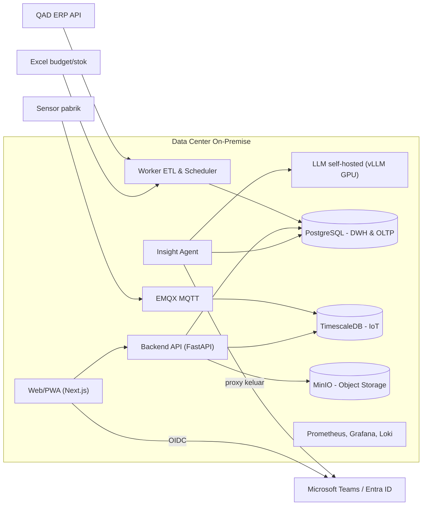
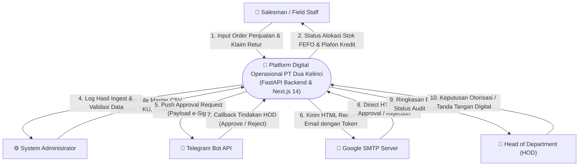
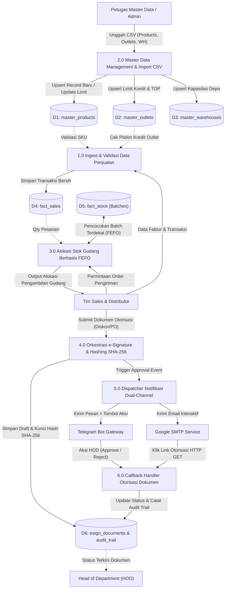

# Arsitektur Sistem

Versi 0.2 · 24 Nov 2026 · Acuan: [SRS.md](SRS.md), [DECISIONS.md](DECISIONS.md)

## 1. Konteks Sistem On-Premise

## 2. Komponen & Tanggung Jawab

| Komponen | Tanggung Jawab Teknis |
|---|---|
| Web/PWA | Dashboard analitik, e-Signature, Gudang, HR, Rute Sales, IoT view (Bahasa Indonesia). |
| Backend API | Layanan REST FastAPI, RBAC, Row-Level Security, audit trail, validasi bisnis. |
| Worker ETL | Sinkronisasi data QAD API & Excel, pembersihan data, karantina baris cacat. |
| Scheduler | Penjadwalan Celery Beat untuk ringkasan harian/mingguan (07.00 WIB) dan ingest. |
| Insight Agent | Komputasi SQL deterministik, pembuatan narasi via vLLM, verifikasi numerik, Adaptive Card. |
| PostgreSQL | Skema `staging`, `dwh` (star schema), `app` (operasional internal). |
| TimescaleDB | Penyimpanan deret waktu sensor IoT pabrik, agregasi continuous 1m & 1h. |
| MinIO | Object storage penyimpanan dokumen PDF e-sign bertanda tangan dan foto absensi. |

## 3. Cakupan Domestik & Tata Kelola Waktu (ADR-008)
- Beroperasi khusus untuk wilayah Indonesia: mata uang tunggal IDR, tanpa konversi kurs.
- Waktu data disimpan dalam UTC di basis data dan ditampilkan dalam zona **WIB (Asia/Jakarta)**.
- Nilai `entity_code` (default `ID01`) dipertahankan untuk identifikasi pabrik dan entitas internal.
- Alokasi Server GPU: kapasitas VRAM dialokasikan terpisah (vLLM dibatasi 60%, 40% untuk analitik IoT).

## 4. Keamanan & Ketersediaan Tinggi (HA)
- Autentikasi terpusat via Microsoft Entra ID (OIDC PKCE); hak akses data dibatasi oleh PostgreSQL RLS.
- Klaster Kubernetes on-premise HA (RKE2) dengan cadangan data harian PostgreSQL dan WAL archiving (RPO ≤ 24 jam, RTO ≤ 4 jam).
- Referensi dokumen teknis terkait:
  - [DATABASE-DESIGN.md](DATABASE-DESIGN.md)
  - [API-SPECIFICATION.md](API-SPECIFICATION.md)
  - [EVENT-DESIGN.md](EVENT-DESIGN.md)
  - [SECURITY.md](SECURITY.md)
  - [OBSERVABILITY.md](OBSERVABILITY.md)
  - [GUARDRAILS.md](GUARDRAILS.md)

---

## 5. Data Flow Diagram (DFD) Operasional

### 5.1 DFD Level 0 (Context Diagram)

### 5.2 DFD Level 1 (Dekomposisi Proses Inti)

