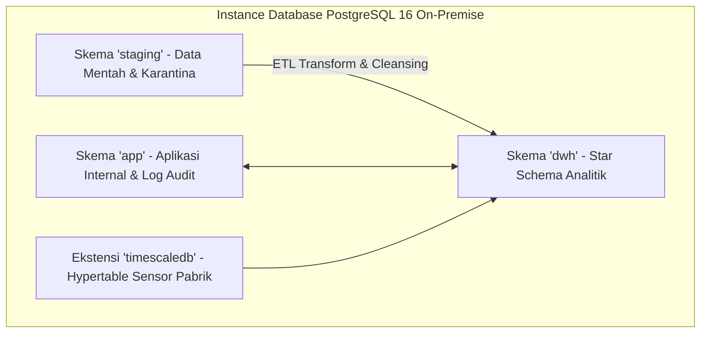
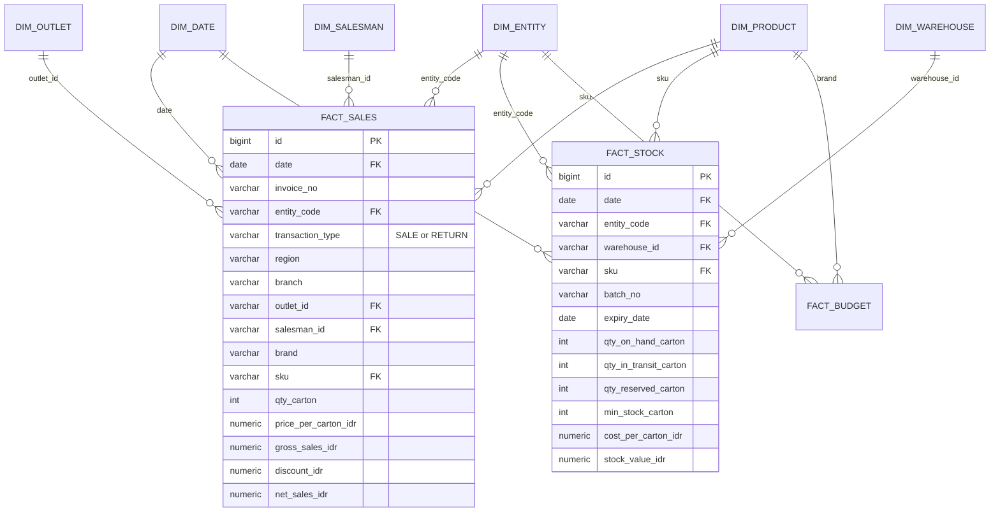
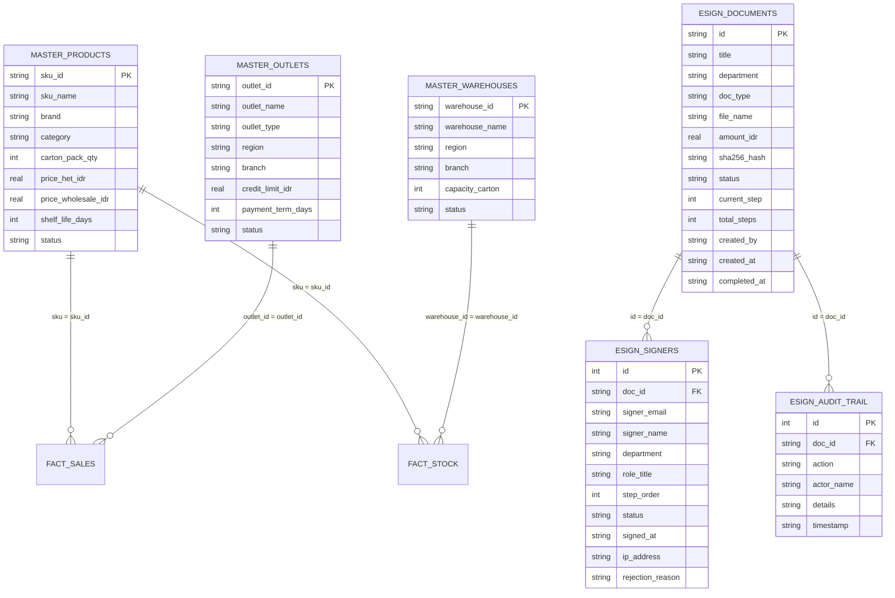

# DATABASE DESIGN — Desain Skema Basis Data Terpadu
## Platform Digital Operasional Kacang Dua Kelinci

| Item | Nilai |
|---|---|
| Versi | 0.1 (Draft) |
| Tanggal | 24 Nov 2026 |
| Status | Menunggu review stakeholder |
| Acuan | [SRS.md](SRS.md), [DATA-DICTIONARY.md](DATA-DICTIONARY.md), [DECISIONS.md](DECISIONS.md) |

---

## 1. Arsitektur Multi-Schema PostgreSQL 16 & TimescaleDB

Sistem basis data dirancang menggunakan pembagian skema logis untuk memisahkan beban kerja pembersihan data (*staging*), gudang data analitik (*star schema dwh*), operasional aplikasi internal (*oltp app*), dan deret waktu sensor (*timescaledb iot*):



---

## 2. Diagram Relasi Entitas Data Warehouse (Star Schema `dwh`)



---

## 3. Definisi Struktur Tabel Utama

### 3.1 Skema `staging` (Pembersihan Data)
- **`stg_sales_raw`:** Menampung data mentah impor CSV/API sebelum validasi. Kolom mencakup seluruh teks baris sumber.
- **`staging.quarantine`:**
  - `id`: `BIGSERIAL PRIMARY KEY`
  - `source_file`: `VARCHAR(255)`
  - `row_number`: `INT`
  - `error_code`: `VARCHAR(50)` (misal: `ERR_ARITHMETIC_MISMATCH`, `ERR_UNKNOWN_SKU`, `ERR_INVALID_DATE`)
  - `error_details`: `TEXT`
  - `raw_data`: `JSONB`
  - `created_at`: `TIMESTAMPTZ DEFAULT NOW()`

### 3.2 Skema `dwh` (Gudang Data Analitik)
- **`dim_region_alias`:**
  - `alias`: `VARCHAR(50) PRIMARY KEY` (contoh: `'JABAR'`, `'jawa barat'`, `'JABODETABEK'`)
  - `canonical_region`: `VARCHAR(50) NOT NULL` (contoh: `'Jawa Barat'`, `'Jabodetabek'`)
- **`dim_product`:**
  - `sku`: `VARCHAR(80) PRIMARY KEY`
  - `brand`: `VARCHAR(50) NOT NULL`
  - `pack_size`: `VARCHAR(50)`
  - `is_active`: `BOOLEAN DEFAULT TRUE`
- **`dim_warehouse`:**
  - `warehouse_id`: `VARCHAR(20) PRIMARY KEY` (format unik: `WH-BDG` Bandung, `WH-BJM` Banjarmasin)
  - `warehouse_name`: `VARCHAR(100) NOT NULL`
  - `branch`: `VARCHAR(50) NOT NULL`
  - `region`: `VARCHAR(50) NOT NULL`
- **`fact_sales`:**
  - Partisi bulanan berbasis kolom `date` (`PARTITION BY RANGE (date)`).
  - Indeks majemuk: `CREATE INDEX idx_sales_query ON dwh.fact_sales(region, branch, brand, date);`
  - Kunci unik penjamin idempoten: `UNIQUE (entity_code, invoice_no, sku)`.

### 3.3 Skema `app` (Aplikasi Internal & Hak Akses)
- **`app.users`:**
  - `id`: `UUID PRIMARY KEY DEFAULT gen_random_uuid()`
  - `email`: `VARCHAR(100) UNIQUE NOT NULL` (akun SSO Entra ID)
  - `full_name`: `VARCHAR(100) NOT NULL`
  - `role`: `VARCHAR(30) NOT NULL` (`admin`, `head_sales`, `head_region`, `brand_manager`, dll.)
  - `is_active`: `BOOLEAN DEFAULT TRUE`
- **`app.user_scope`:**
  - `id`: `BIGSERIAL PRIMARY KEY`
  - `user_id`: `UUID REFERENCES app.users(id)`
  - `scope_type`: `VARCHAR(20) NOT NULL` (`NATIONAL`, `REGION`, `BRANCH`, `BRAND`)
  - `scope_value`: `VARCHAR(50) NOT NULL` (contoh: `'Jawa Barat'`, `'Sukro'`, `'ALL'`)
- **`app.esign_documents`:**
  - `id`: `UUID PRIMARY KEY DEFAULT gen_random_uuid()`
  - `title`: `VARCHAR(255) NOT NULL`
  - `file_url`: `VARCHAR(500) NOT NULL` (path MinIO)
  - `sha256_hash`: `CHAR(64) NOT NULL`
  - `status`: `VARCHAR(20) NOT NULL` (`DRAFT`, `IN_PROGRESS`, `COMPLETED`, `REJECTED`, `EXPIRED`)
  - `created_by`: `UUID REFERENCES app.users(id)`
  - `created_at`: `TIMESTAMPTZ DEFAULT NOW()`

### 3.4 Skema `iot` (TimescaleDB)
- **`sensor_telemetry`:**
  - Hypertable deret waktu: `CREATE EXTENSION IF NOT EXISTS timescaledb;`
  - Kolom: `time TIMESTAMPTZ NOT NULL`, `machine_id VARCHAR(50)`, `line_id VARCHAR(30)`, `metric_name VARCHAR(50)`, `metric_value DOUBLE PRECISION`, `status VARCHAR(20)`.
  - Partisi per 7 hari (`chunk_time_interval => INTERVAL '7 days'`).
  - Kebijakan retensi 12 bulan dan kompresi otomatis untuk data berumur > 7 hari.

---

## 4. Kebijakan Row-Level Security (RLS) PostgreSQL

Untuk menjamin pemisahan data di tingkat mesin database, RLS diterapkan pada tabel fakta analitik:
```sql
ALTER TABLE dwh.fact_sales ENABLE ROW LEVEL SECURITY;

CREATE POLICY rls_fact_sales_policy ON dwh.fact_sales
  FOR SELECT
  USING (
    EXISTS (
      SELECT 1 FROM app.user_scope us
      WHERE us.user_id = NULLIF(current_setting('app.current_user_id', true), '')::uuid
        AND (
          (us.scope_type = 'NATIONAL') OR
          (us.scope_type = 'REGION' AND us.scope_value = dwh.fact_sales.region) OR
          (us.scope_type = 'BRAND' AND us.scope_value = dwh.fact_sales.brand)
        )
    )
  );
```


---

## 5. ERD Master Data & e-Signature (Update Terkini)

Berikut adalah diagram relasi entitas lengkap yang menghubungkan tabel fakta penjualan/stok dengan Master Data Management (Produk, Outlet, Gudang) dan Modul e-Signature HOD:


