# RANCANGAN e-SIGNATURE BERDASARKAN HEAD OF DEPARTMENT (HOD)
## PT Dua Kelinci — Platform Digital Operasional

| Item | Nilai |
|---|---|
| Versi | 1.0 |
| Tanggal | 24 Nov 2026 |
| Status | Siap Implementasi |
| Departemen Terkait | Sales, Marketing, Finance, Warehouse |
| Acuan | [BRD.md](BRD.md), [SRS.md](SRS.md), [SECURITY.md](SECURITY.md), [FSD.md](FSD.md) |

---

## 1. Latar Belakang & Prinsip Tata Kelola

Modul **e-Signature Internal** dirancang untuk menggantikan alur birokrasi manual kertas pada dokumen operasional lintas departemen PT Dua Kelinci. Modul ini beroperasi dengan prinsip:
1. **Segregation of Duties (SoD):** Pembuat (*Inisiator/Requester*), Peninjau (*Reviewer*), dan Penyetujui (*Approver*) tidak boleh orang yang sama.
2. **Kewenangan Bertingkat (*Tiered Approval Limit*):** Dokumen bernilai finansial tertentu wajib disetujui hingga Head of Department atau Direksi.
3. **Integritas Tak Terbantahkan (*Non-Repudiation*):** Setiap tanda tangan diverifikasi melalui akun SSO Microsoft Entra ID korporat, stempel hash SHA-256 dokumen, stempel waktu NTP WIB, dan pencatatan alamat IP pada sertifikat audit (*audit certificate*).

---

## 2. Matriks Dokumen & Otorisasi per Head of Department

| Departemen | Head of Department (HOD) | Dokumen Kunci yang Dikelola | Peran dalam Dokumen | Ambang Batas Otorisasi |
|---|---|---|---|---|
| **SALES** | **Head of Sales** (*Muhammad Wyzer*) | 1. Sales Order Eksepsional / Plafon Kredit<br>2. Pengajuan Retur Produk Cabang (`RTR`)<br>3. Perjanjian Kerjasama Distributor Baru | **Approver Utama (Sales)**<br>Penyetujui alokasi kuota dan dispensasi harga cabang. | &bull; SO Eksepsional s.d. Rp 500 Juta<br>&bull; Retur produk kadaluwarsa/rusak |
| **MARKETING** | **Head of Marketing** (*Maya Indah*) | 1. Memo Alokasi Budget Promosi / Event<br>2. Pengajuan Diskon Khusus Modern Market<br>3. Desain & Cetak Kemasan Baru Produk | **Approver Utama (Marketing)**<br>Penyetujui belanja promosi brand & diskon khusus. | &bull; Budget promosi per brand s.d. Rp 300 Juta<br>&bull; Diskon dagang $> 7\%$ |
| **FINANCE** | **Head of Finance** (*Rudi Hartono*) | 1. Pembayaran Faktur Tagihan (Invoice / PV)<br>2. Purchase Order Bahan Baku / Kemasan<br>3. Berita Acara Selisih Stock Opname | **Final Financial Approver**<br>Verifikator anggaran, cash flow, dan kepatuhan audit. | &bull; PO Finansial s.d. Rp 1 Miliar<br>&bull; Penyesuaian nilai buku selisih stok |
| **WAREHOUSE** | **Head of Warehouse** (*Dedi Kurniawan*) | 1. Surat Jalan & Delivery Order (DO)<br>2. Pengajuan Mutasi Stok Antar-Gudang (Inter-depo)<br>3. Berita Acara Pemusnahan Barang Rusak | **Operational Approver**<br>Penyetujui pergerakan fisik barang dan alokasi kapasitas gudang. | &bull; Mutasi fisik karton tanpa batas kuantum<br>&bull; Rekomendasi barang afkir / FEFO |

---

## 3. Matriks Alur Persetujuan Lintas Departemen (Cross-Department Workflow)

Dokumen operasional sering melibatkan lebih dari satu departemen. Berikut adalah matriks alur persetujuan terstandarisasi:

```mermaid
flowchart TD
  subgraph Tipe_1 ["1. Pengajuan Diskon Khusus / Promosi"]
    REQ1[Salesman / BM] --> H_SALES1[Head of Sales - Review Kelayakan]
    H_SALES1 --> H_MKT1[Head of Marketing - Alokasi Budget Promo]
    H_MKT1 --> H_FIN1[Head of Finance - Validasi Margin & Persetujuan]
    H_FIN1 --> COMP1[Dokumen Selesai & SHA-256 Stamped]
  end

  subgraph Tipe_2 ["2. Retur Barang & Selisih Stok Opname"]
    REQ2[Admin Gudang Cabang] --> H_WH2[Head of Warehouse - Cek Fisik & FEFO]
    H_WH2 --> H_SALES2[Head of Sales - Validasi Faktur Penjualan]
    H_SALES2 --> H_FIN2[Head of Finance - Penyesuaian Nilai Buku Finansial]
    H_FIN2 --> COMP2[Dokumen Selesai & Eksekusi Jurnal QAD]
  end

  subgraph Tipe_3 ["3. Pengadaan Kemasan & Bahan Baku"]
    REQ3[Staff Purchasing] --> H_MKT3[Head of Marketing - Validasi Spesifikasi]
    H_MKT3 --> H_WH3[Head of Warehouse - Konfirmasi Kapasitas Depo]
    H_WH3 --> H_FIN3[Head of Finance - Persetujuan PO & Pembayaran]
    H_FIN3 --> COMP3[Terbit PO Resmi ke Vendor]
  end
```



---

## 4. Rincian Alur Kerja Tiap Departemen

### 4.1 Dokumen Departemen Sales
- **Dokumen: *Sales Order Khusus & Dispensasi Piutang (Overlimit Creditor)***
  - *Tujuan:* Memberikan izin pengiriman barang kepada grosir besar yang plafon kreditnya sedang melampaui batas.
  - *Urutan Tanda Tangan (Serial):*
    1. **Inisiator:** Salesman / Supervisor Area.
    2. **Reviewer:** Branch Manager wilayah terkait.
    3. **Penyetujui Teknis:** **Head of Sales** (memastikan omzet dan target cabang tercapai).
    4. **Penyetujui Finansial:** **Head of Finance** (menilai risiko gagal bayar).

### 4.2 Dokumen Departemen Marketing
- **Dokumen: *Trade Promotion & Proposal Diskon Modern Market***
  - *Tujuan:* Program potongan harga bertingkat (misal: diskon 8% untuk pembelian grosir Sukro Pedas).
  - *Urutan Tanda Tangan (Serial):*
    1. **Inisiator:** Brand Manager (BM Sukro / Dua Kelinci).
    2. **Penyetujui Marketing:** **Head of Marketing** (memverifikasi kuota budget promosi brand).
    3. **Penyetujui Sales:** **Head of Sales** (menilai proyeksi lonjakan volume penjualan).
    4. **Penyetujui Finansial:** **Head of Finance** (memastikan margin laba bersih tidak minus).

### 4.3 Dokumen Departemen Warehouse (Gudang & Logistik)
- **Dokumen: *Berita Acara Mutasi Antar-Depo & Pemusnahan Produk Afkir***
  - *Tujuan:* Otorisasi pemindahan stok dari Gudang Pusat (Pati) ke Depo Cabang (misal: WH-BDG) atau pemusnahan barang rusak/kedaluwarsa.
  - *Urutan Tanda Tangan (Serial):*
    1. **Inisiator:** Kepala Gudang Asal.
    2. **Penyetujui Logistik:** **Head of Warehouse** (memverifikasi kepatuhan batch FEFO dan armada truk).
    3. **Penyetujui Finansial:** **Head of Finance** (untuk penghapusan aset persediaan / penyesuaian HPP).

### 4.4 Dokumen Departemen Finance
- **Dokumen: *Purchase Order (PO) & Payment Voucher Belanja Modal/Bahan***
  - *Tujuan:* Pembayaran faktur supplier kacang tanah mentah, minyak, bumbu, atau mesin pengemasan.
  - *Urutan Tanda Tangan (Serial):*
    1. **Inisiator:** Bagian Pengadaan (*Procurement*).
    2. **Penyetujui Pemohon:** Head of Department pemohon (Sales/Marketing/Warehouse).
    3. **Final Approver:** **Head of Finance** (pencairan dana dan penerbitan instruksi bank transfer).

---

## 5. Model Data Dukungan Multi-HOD

Tabel pendukung pada database PostgreSQL skema `app`:

```sql
-- 1. Master Jenis Dokumen dan Template Alur
CREATE TABLE app.esign_document_templates (
    template_code VARCHAR(30) PRIMARY KEY,
    template_name VARCHAR(100) NOT NULL,
    owning_department VARCHAR(30) NOT NULL, -- SALES, MARKETING, FINANCE, WAREHOUSE
    required_signers JSONB NOT NULL
);

-- 2. Dokumen e-Signature Aktif
CREATE TABLE app.esign_documents (
    id UUID PRIMARY KEY DEFAULT gen_random_uuid(),
    template_code VARCHAR(30) REFERENCES app.esign_document_templates(template_code),
    title VARCHAR(255) NOT NULL,
    department VARCHAR(30) NOT NULL,
    file_url VARCHAR(500) NOT NULL,
    sha256_hash CHAR(64) NOT NULL,
    status VARCHAR(20) NOT NULL, -- DRAFT, IN_PROGRESS, COMPLETED, REJECTED, EXPIRED
    current_step INTEGER DEFAULT 1,
    total_steps INTEGER NOT NULL,
    created_by VARCHAR(100) NOT NULL,
    created_at TIMESTAMPTZ DEFAULT NOW(),
    completed_at TIMESTAMPTZ
);

-- 3. Daftar Penandatangan (Signers per Step)
CREATE TABLE app.esign_signers (
    id BIGSERIAL PRIMARY KEY,
    doc_id UUID REFERENCES app.esign_documents(id),
    signer_email VARCHAR(100) NOT NULL,
    signer_name VARCHAR(100) NOT NULL,
    department VARCHAR(30) NOT NULL,
    role_title VARCHAR(50) NOT NULL, -- Head of Sales, Head of Marketing, dll.
    step_order INTEGER NOT NULL,
    status VARCHAR(20) NOT NULL, -- PENDING, SIGNED, REJECTED
    signed_at TIMESTAMPTZ,
    ip_address VARCHAR(45),
    rejection_reason TEXT
);

-- 4. Jejak Audit Kriptografis (Append-Only)
CREATE TABLE app.esign_audit_trail (
    id BIGSERIAL PRIMARY KEY,
    doc_id UUID REFERENCES app.esign_documents(id),
    action VARCHAR(50) NOT NULL,
    actor_email VARCHAR(100) NOT NULL,
    actor_name VARCHAR(100) NOT NULL,
    department VARCHAR(30) NOT NULL,
    timestamp TIMESTAMPTZ DEFAULT NOW(),
    ip_address VARCHAR(45),
    details TEXT
);
```

---

## 6. Antarmuka dan Notifikasi Pengingat

1. **Notifikasi Microsoft Teams & Email Otomatis:**
   - Ketika dokumen mencapai langkah (*step*) persetujuan HOD terkait, bot akan mengirimkan kartu *Approval Card* ke Teams & Email HOD tersebut.
   - Contoh kartu memuat: Judul memo, Departemen pengaju, Nilai nominal (jika ada), dan tombol persetujuan cepat: **[Setujui via SSO]** atau **[Tolak dengan Alasan]**.
2. **Sertifikat Penyelesaian (*Completion Certificate*):**
   - Halaman terakhir pada berkas PDF final memuat matriks stempel stempel digital dengan kode QR verifikasi keaslian hash SHA-256.
