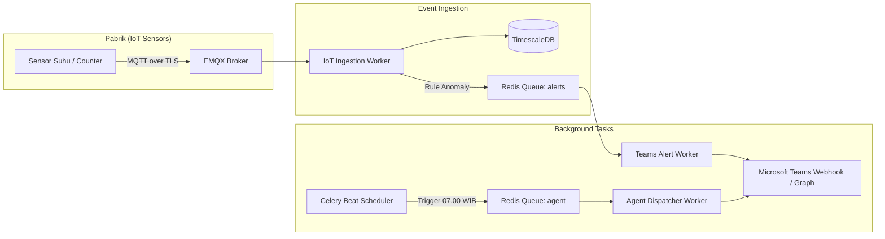

# EVENT DESIGN — Desain Arsitektur Event & Pesan
## Platform Digital Operasional Kacang Dua Kelinci

| Item | Nilai |
|---|---|
| Versi | 0.1 (Draft) |
| Tanggal | 24 Nov 2026 |
| Status | Menunggu review stakeholder |
| Acuan | [SRS.md](SRS.md), [ARCHITECTURE.md](ARCHITECTURE.md), [FSD.md](FSD.md) |

---

## 1. Topologi Perutean Event Sistem

Platform membedakan dua jenis lalu lintas event:
1. **Layanan Asinkron & Antrean Internal:** Menggunakan **Celery dengan Redis Broker** untuk tugas latar belakang sistem (ETL, komputasi KPI, pembuatan PDF, pengiriman pesan Teams).
2. **Telemetri Pabrik Real-Time:** Menggunakan **EMQX MQTT Broker** untuk penerimaan telemetri sensor mesin berkecepatan tinggi dari lantai produksi.



---

## 2. Standar Amplop Event Terpadu (*Unified Event Envelope*)

Seluruh event yang didistribusikan antar-modul internal dibungkus dalam skema JSON baku:
```json
{
  "event_id": "evt-7f8e9d0c-1b2a-4c3d-8e9f-0a1b2c3d4e5f",
  "event_type": "kacang.iot.machine_anomaly_detected",
  "version": "1.0",
  "producer": "service-iot-monitor",
  "occurred_at": "2026-11-24T04:15:30.123Z",
  "entity_code": "ID01",
  "correlation_id": "cor-3c2b1a0f-9e8d-7c6b-5a4f-3e2d1c0b9a8f",
  "payload": {
    "plant_id": "PLANT-PATI-01",
    "line_id": "LINE-ROASTING-2",
    "machine_id": "MC-ROAST-04",
    "metric": "temperature_celsius",
    "current_value": 195.8,
    "threshold_max": 180.0,
    "severity": "CRITICAL"
  }
}
```

---

## 3. Desain Topik MQTT Sensor Pabrik

Topik MQTT dirancang hierarkis untuk memudahkan *wildcard subscription*:
- **Pola Topik Telemetri:** `kacang/{entity_code}/{plant_id}/{line_id}/{machine_id}/telemetry`
  - Contoh: `kacang/ID01/PATI01/ROASTING/MC04/telemetry`
  - QoS: `QoS 1` (At least once).
  - Payload Telemetri:
    ```json
    {
      "ts": 1795500930,
      "temp_c": 172.5,
      "humidity_pct": 54.2,
      "pack_counter": 1420,
      "speed_rpm": 120
    }
    ```
- **Pola Topik Status Mesin (Last Will & Testament):** `kacang/{entity_code}/{plant_id}/{line_id}/{machine_id}/status`
  - Menggunakan fitur MQTT LWT (*Last Will and Testament*) dengan status `ONLINE` saat menyala dan `OFFLINE` saat terputus secara mendadak.
  - QoS: `QoS 1`, Retained: `true`.

---

## 4. Jadwal Cron & Pemicu Terjadwal (WIB / Asia/Jakarta)

| Pola Waktu | Waktu Eksekusi (WIB) | ID Tugas / Event | Deskripsi Tindakan |
|---|---|---|---|
| `0 6 * * *` | Setiap hari 06.00 WIB | `etl.qad.sync_daily_sales` | Sinkronisasi data penjualan dan mutasi stok final dari ERP QAD. |
| `0 7 * * *` | Setiap hari 07.00 WIB | `agent.dispatch_daily_summary` | Kalkulasi KPI dan pengiriman ringkasan harian ke manajer via Teams. |
| `0 7 * * 1` | Setiap Senin 07.00 WIB | `agent.dispatch_weekly_summary` | Kalkulasi performa mingguan (WoW) dan target sisa bulan berjalan. |
| `0 */1 * * *` | Setiap jam genap | `wh.evaluate_critical_stock` | Evaluasi stok di bawah batas aman dan penerbitan peringatan gudang. |
| `*/1 * * * *` | Setiap 1 menit | `iot.evaluate_offline_machines` | Memindai mesin pabrik yang tidak mengirim detak telemetri > 120 detik. |
