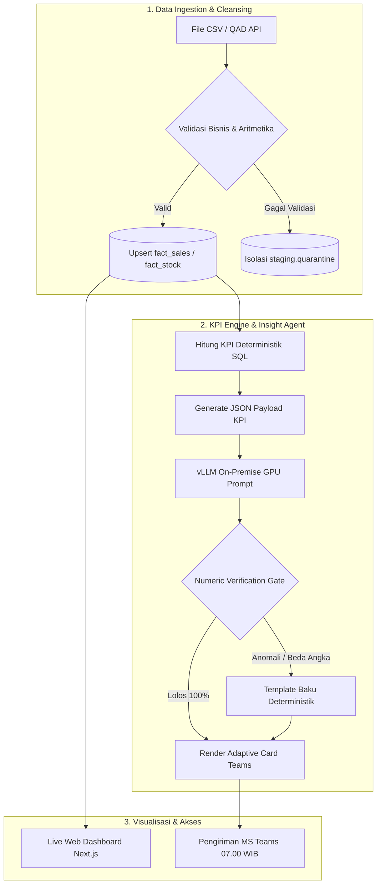
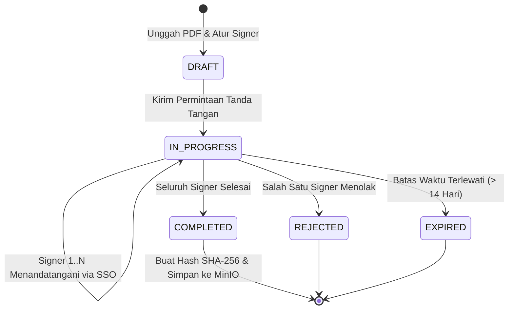
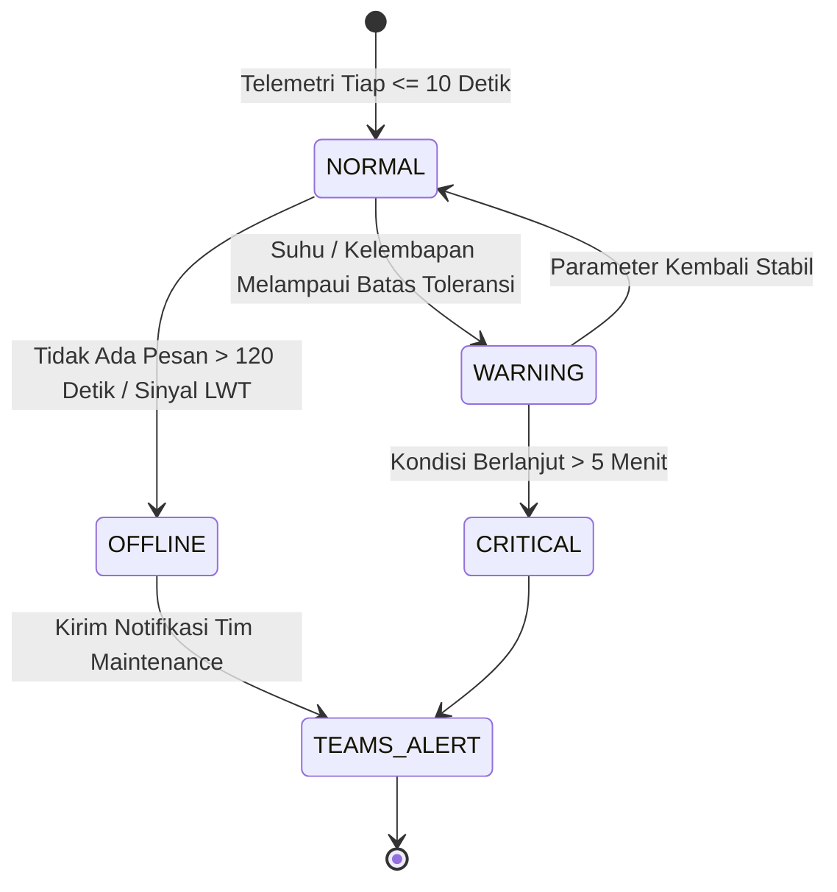

# FSD — Functional Specification Document
## Platform Digital Operasional Kacang Dua Kelinci

| Item | Nilai |
|---|---|
| Versi | 0.1 (Draft) |
| Tanggal | 24 Nov 2026 |
| Status | Menunggu review stakeholder |
| Acuan | [BRD.md](BRD.md), [SRS.md](SRS.md), [DATABASE-DESIGN.md](DATABASE-DESIGN.md) |

---

## 1. Arsitektur Alur & Logika Bisnis Modul



---

## 2. Spesifikasi Layanan Ingesti & Pembersihan Data (ETL)

### 2.1 Alur Validasi Transaksi Penjualan
Setiap baris data penjualan yang masuk melalui unggahan file maupun sinkronisasi API wajib melalui tahapan pengujian berikut:
1. **Pembersihan String & Normalisasi:** Menghapus spasi awal/akhir (*whitespace stripping*) pada seluruh kolom teks.
2. **Pemetaan Wilayah (Region Aliasing):** Melakukan pengecekan *case-insensitive* ke kamus alias:
   - `'jabar'`, `'jawa barat'`, `'JAWA BARAT'` $\rightarrow$ dipetakan ke `'Jawa Barat'`.
   - `'jabodetabek'`, `'JABODETABEK'` $\rightarrow$ dipetakan ke `'Jabodetabek'`.
   - `'jawa timur'`, `'JAWA TIMUR'` $\rightarrow$ dipetakan ke `'Jawa Timur'`.
3. **Pemeriksaan Tipe Transaksi & Nilai:**
   - Jika nomor invoice berawalan `'RTR'` dan `qty_carton < 0`: ditandai sebagai `transaction_type = 'RETURN'`.
   - Jika faktur standar: wajib memiliki `qty_carton > 0`.
   - Validasi matematika:
     $$\text{Selisih Gross} = |(\text{qty\_carton} \times \text{price\_per\_carton\_idr}) - \text{gross\_sales\_idr}| \le 1.0$$
     $$\text{Selisih Net} = |(\text{gross\_sales\_idr} - \text{discount\_idr}) - \text{net\_sales\_idr}| \le 1.0$$
4. **Penanganan Salesman Kosong:** Jika kolom `salesman` kosong, otomatis diisi string `'UNASSIGNED'` dan dicatat dalam metrik kualitas data.
5. **Karantina:** Baris yang gagal pada tahap validasi dimasukkan ke tabel `staging.quarantine` dengan kolom `error_code`, `error_message`, dan `raw_payload`.

---

## 3. Spesifikasi Dashboard Live Web Mandiri

### 3.1 Struktur Layar & Tata Letak Berdasarkan Peran

```
+---------------------------------------------------------------------------------+
| [Logo Dua Kelinci]  Portal Operasional Terpadu            [User: Budi - BM Sukro] |
| Wilayah: [Nasional v]  Cabang: [Semua v]  Periode: [Sep-Okt 2026 v]   (Export v)  |
+---------------------------------------------------------------------------------+
| [ KPI Net Sales ]   [ % Achievement ]   [ Diskon Rata2 ]   [ Stok Kritis SKU ]  |
| Rp 2.450.000.000     94.2% vs Budget        4.8%             2 Depo Cabang      |
+---------------------------------------------------------------------------------+
| Tren Penjualan Harian (ECharts Line Chart)    | Distribusi Outlet (Pie Chart)    |
| [ Grafik Fluktuasi Omzet Harian ]             | Grosir (65%), Retail (35%)       |
+---------------------------------------------------------------------------------+
| Tabel Kinerja SKU / Cabang (Data Grid Interaktif dengan Sort & Pagination)      |
| SKU                       Qty (Karton)   Net Sales (Rp)   Target (Rp)   Ach (%) |
| Sukro Pedas 100g             1.250         232.500.000    240.000.000    96.8%  |
| Sukro Original 100g          1.100         198.000.000    210.000.000    94.2%  |
+---------------------------------------------------------------------------------+
```

### 3.2 Logika Perhitungan Metrik Finansial & Operasional
- **Gross Sales:** $\sum \text{gross\_sales\_idr}$
- **Discount Total:** $\sum \text{discount\_idr}$
- **Net Sales:** $\sum \text{net\_sales\_idr}$ (faktur penjualan dikurangi retur).
- **Target Achievement (%):**
  $$\text{Achievement} = \left(\frac{\text{Realisasi Net Sales}}{\text{Budget Net Sales}}\right) \times 100\%$$
- **Pertumbuhan DoD / WoW / MTD (%):**
  $$\text{Growth} = \left(\frac{\text{Net Sales Periode Ini} - \text{Net Sales Periode Acuan}}{\text{Net Sales Periode Acuan}}\right) \times 100\%$$
- **Days of Cover (Stok Depo):**
  $$\text{Days of Cover} = \frac{\text{Stok Tersedia (Karton)}}{\text{Rata-rata Penjualan Harian 28 Hari Terakhir}}$$
  *Aturan:* Jika $\text{Days of Cover} < 7$ hari atau $\text{Stok Tersedia} < \text{Stok Minimum}$, tandai sebagai **Stok Kritis**.

---

## 4. Spesifikasi AI Insight Agent & Integrasi Microsoft Teams

### 4.1 Format Payload Data Menuju LLM
Mesin analitik menyusun ringkasan teragregasi dalam bentuk JSON deterministik sebelum diserahkan ke prompt model vLLM:
```json
{
  "manager_name": "Agus Setiawan",
  "scope": "Brand Manager - Sukro",
  "period": "2026-10-31",
  "metrics": {
    "net_sales_idr": 4835000000,
    "budget_idr": 5000000000,
    "achievement_pct": 96.7,
    "growth_dod_pct": 3.4,
    "top_performing_sku": "Sukro Pedas 100g",
    "top_performing_region": "Jawa Timur",
    "critical_stock_alerts": [
      {"branch": "Semarang", "sku": "Sukro Original 100g", "days_of_cover": 4}
    ]
  }
}
```

### 4.2 Aturan Validasi Verifikasi Numerik (Numeric Gate)
1. Regex scanner mengekstrak semua angka integer, desimal, persentase, dan nominal mata uang dari respons teks AI.
2. Setiap angka yang diekstrak dicocokkan dengan set angka yang ada pada payload JSON sumber.
3. Toleransi format teks: penulisan desimal dengan tanda koma (`,`) atau titik (`.`) disetarakan.
4. Jika ditemukan selisih nilai > 0.01% atau angka asing yang tidak terdaftar di JSON sumber, teks AI langsung di-drop dan digantikan dengan template baku otomatis:
   > *"Halo [Nama], berikut ringkasan kinerja per [Tanggal]: Penjualan Bersih tercatat Rp [Net Sales] (Pencapaian [Ach]% vs Budget). Perhatian: Terdapat [N] SKU berstatus stok kritis di depo cabang. Silakan buka dashboard untuk rincian lengkap."*

---

## 5. Spesifikasi State Machine Modul Internal

### 5.1 Siklus Hidup Dokumen e-Signature



### 5.2 Alur Pergudangan FEFO (WMS Ringan)
1. **Goods Receipt (Penerimaan):** Perekaman nomor PO, scan barcode karton, pencatatan kode batch unik, dan tanggal kedaluwarsa.
2. **Penyimpanan (Putaway):** Sistem menetapkan lokasi rak/zona gudang berdasarkan volume barang.
3. **Picking Order (Pengeluaran Barang):** Ketika Delivery Order (DO) terbit, sistem mengunci (*reserve*) stok dari batch dengan masa kedaluwarsa paling dekat. Operator gudang tidak diizinkan mengambil batch lebih baru apabila batch lama masih tersedia.

### 5.3 Alur Monitoring IoT & Penanganan Mesin Macet


