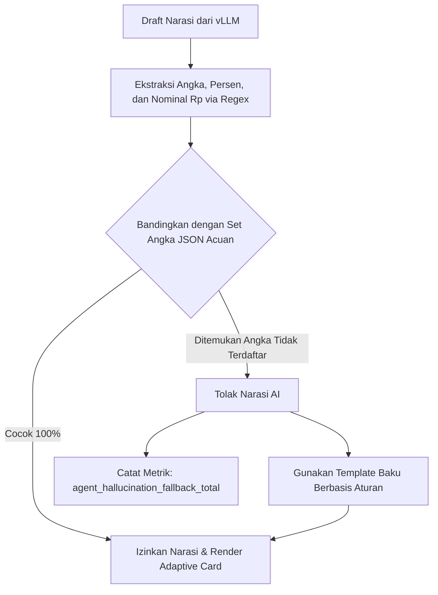

# GUARDRAILS — Pembatasan & Penjaga Keandalan Sistem
## Platform Digital Operasional Kacang Dua Kelinci

| Item | Nilai |
|---|---|
| Versi | 0.1 (Draft) |
| Tanggal | 24 Nov 2026 |
| Status | Menunggu review stakeholder |
| Acuan | [SRS.md](SRS.md), [FSD.md](FSD.md), [SECURITY.md](SECURITY.md) |

---

## 1. Kebijakan Anti-Halusinasi AI (*Zero-Math AI Policy*)

Untuk memastikan akurasi data finansial perusahaan, ditetapkan guardrail ketat bagi model AI:
1. **Larangan Komputasi oleh AI:** Model vLLM dilarang melakukan operasi penjumlahan, pengurangan, pembagian rasio, atau pengalian. Seluruh metrik KPI wajib dihitung terlebih dahulu oleh query SQL deterministik di PostgreSQL.
2. **Peran Tunggal Model AI:** AI hanya bertindak sebagai generator narasi kalimat deskriptif dalam Bahasa Indonesia yang lugas dan profesional berdasarkan angka yang sudah disediakan pada JSON input.

---

## 2. Gerbang Verifikasi Numerik (*Numeric Verification Gate*)

Sebelum pesan narasi AI diizinkan dikirim ke Microsoft Teams, modul `NumericVerificationGate` melakukan pemindaian otomatis:

- **Aturan Peringatan:** Jika rasio fallback template melebihi 5% dalam satu hari eksekusi, sistem secara otomatis memicu alert prioritas tinggi ke tim IT Operasional untuk evaluasi prompt vLLM.

---

## 3. Pembatasan Sumber Daya Server GPU On-Premise

Server GPU fisik digunakan bersama untuk dua beban kerja penting:
1. **Inferensi AI Insight Agent (vLLM):** Berjalan secara berkala (batch) pada pagi hari.
2. **Analisis Deret Waktu & Deteksi Anomali IoT Pabrik:** Berjalan secara berkelanjutan.

**Kebijakan Guardrail Alokasi GPU:**
- Alokasi memori vLLM dibatasi maksimal 60% dari VRAM GPU total (`--gpu-memory-utilization 0.60`).
- Sisa kapasitas VRAM 40% dan alokasi compute didedikasikan untuk pipeline analitik anomali sensor pabrik.
- Jika terjadi insiden kritis anomali pabrik, proses inferensi vLLM ditunda otomatis dengan batas waktu tunggu (*timeout*) eksekusi inferensi 30 detik.

---

## 4. Pembatasan Ingesti Data & Karantina (Data Quality Guardrails)

- **Ambang Batas Kegagalan Batch (Batch Circuit Breaker):**
  - Jika jumlah baris gagal validasi dalam satu file unggahan melebihi 10% dari total baris, seluruh proses batch dihentikan (*rollback* parsial).
  - Sistem tidak memasukkan sebagian data valid untuk mencegah distorsi data analitik parsial.
  - Notifikasi darurat dikirim ke channel Teams IT: *"Batch ETL Dibatalkan: Kegagalan Validasi 12.4% Melebihi Batas 10%."*
- **Penanganan Transaksi Negatif:**
  - Hanya transaksi dengan awalan invoice `'RTR'` yang diizinkan memiliki nilai negatif.
  - Faktur reguler yang bernilai kuantitas $\le 0$ langsung dipindahkan ke tabel karantina.
