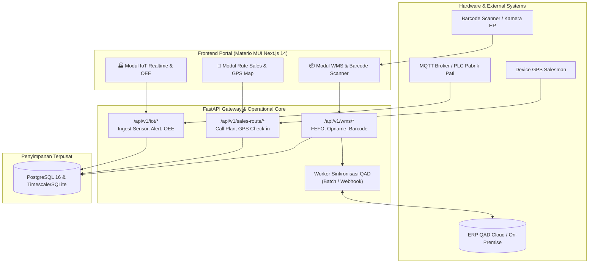

# PRD — Platform Digital Operasional Kacang (Insight Agent, Dashboard Live, Aplikasi Internal)

| Item | Nilai |
|---|---|
| Versi | 0.2 |
| Tanggal | 24 Nov 2026 |
| Status | Menunggu review stakeholder |
| Sumber data awal | `sales.csv` (1.891 baris transaksi, periode Sep–Okt 2026, 6 region, 13 cabang, 8 brand, 13 SKU, 52 outlet) |

---

## 1. Latar Belakang
Hari ini data penjualan, stok, dan budget tersebar di export Excel dan ERP QAD. Manajer menunggu laporan yang disusun manual, sering terlambat dan berbeda versi. Proses internal (tanda tangan dokumen, gudang, HR, rute sales, monitoring mesin pabrik) masih memakai kertas, Excel, atau aplikasi yang tidak saling terhubung.

## 2. Tujuan
1. Manajer menerima ringkasan kinerja **harian dan mingguan** otomatis di Microsoft Teams, tanpa menyusun laporan manual.
2. Brand Manager, Head of Sales, dan Head of Region punya **satu dashboard live** dengan angka yang sama.
3. Proses internal inti berjalan di **satu platform aplikasi** dengan data terhubung.
4. Seluruh sistem punya **log, alert, dan dokumentasi** yang cukup untuk dioperasikan tim kecil.

## 3. Non-Goal (Fase ini)
- Mengganti QAD sebagai sistem pencatatan utama (QAD tetap *system of record*).
- Forecasting / ML prediktif tingkat lanjut (dicatat sebagai fase berikutnya).
- Aplikasi untuk pelanggan/outlet eksternal.
- Payroll penuh (HR fase ini fokus cuti, absensi, data karyawan).

## 4. Persona & Kebutuhan

| Persona | Kebutuhan utama | Kanal |
|---|---|---|
| Brand Manager | Penjualan & margin per brand/SKU vs budget, tren, SKU lambat | Dashboard, Teams |
| Head of Sales | Pencapaian nasional, per salesman, per outlet type, diskon | Dashboard, Teams |
| Head of Region | Kinerja region/branch, stok cabang, pencapaian rute | Dashboard, Teams |
| Manajer cabang / gudang | Stok, mutasi barang, stok kritis | Aplikasi Gudang, Teams alert |
| Salesman | Rute harian, kunjungan, check-in outlet | Aplikasi mobile (web/PWA) |
| HR & karyawan | Pengajuan cuti, absensi, data karyawan | Aplikasi HR |
| Approver dokumen | Tanda tangan elektronik PO, kontrak, memo | Aplikasi e-Signature |
| Supervisor pabrik | Status mesin, suhu, output, downtime | Dashboard IoT, alert |
| Tim IT | Log, alert, kesehatan sistem | Monitoring |

## 5. Ruang Lingkup Fitur

### Modul A — AI Insight Agent (Teams)
- Tarik data penjualan, stok, budget dari QAD/Excel setiap hari.
- Hitung KPI: net sales, achievement vs budget, growth (DoD/WoW/MTD), diskon %, top/bottom SKU, outlet, salesman, stok kritis (days of cover).
- LLM menulis ringkasan naratif singkat dalam Bahasa Indonesia, **angka dihitung oleh kode, bukan oleh LLM**.
- Ringkasan dipersonalisasi sesuai scope manajer (brand / region / nasional).
- Jadwal: harian 07.00 WIB, mingguan Senin 07.00 WIB.
- Fitur tanya-jawab di Teams ("berapa penjualan Sukro di Bekasi minggu lalu?") — fase 2.

### Modul B — Dashboard Live
- Ganti export Excel + QAD dengan data warehouse terpusat dan dashboard web.
- View per persona, filter tanggal/region/branch/brand/SKU/outlet type/salesman.
- Row-level security: Head of Region hanya melihat regionnya, Brand Manager brand-nya.
- Refresh data: minimal tiap jam (target near-real-time bila QAD mendukung).

### Modul C — Aplikasi Internal
1. **e-Signature**: unggah dokumen, alur approval berurutan/paralel, tanda tangan, jejak audit, PDF final ber-hash SHA-256, integrasi notifikasi approval via Gmail & Telegram Bot.
2. **Gudang (WMS ringan)**:
   - **Penerimaan (Inbound)**: Penerimaan dari Pabrik Pati atau Supplier PO, verifikasi no batch & tanggal kedaluwarsa.
   - **Mutasi Antar-Gudang (Transfer)**: Pembuatan Surat Jalan (SJ) relokasi stok antar-depo (status: `ISSUED` → `IN_TRANSIT` → `RECEIVED`), otomatis potong stok asal & tambah stok tujuan.
   - **Pengeluaran (Outbound)**: Alokasi picking pengeluaran barang berbasis **FEFO (First Expired, First Out)**.
   - **Stock Opname**: Pencatatan hitung fisik berkala per rak/batch, kalkulasi selisih (*variance*) fisik vs sistem, approval penyesuaian stok.
   - **Scan Barcode**: Deteksi cepat SKU & batch dari format barcode karton (EAN-13 / GS1-128) via kamera HP / barcode scanner USB.
   - **Sinkronisasi ERP QAD**: Antrean transaksi mutasi stok (`PENDING`, `SYNCED`, `FAILED`) untuk rekonsiliasi data periodik ke QAD.
3. **HR**: data karyawan (Sales & Warehouse), cuti, absensi (geo/foto), approval atasan.
4. **Rute Sales**:
   - **Rencana Kunjungan (Call Plan)**: Jadwal urutan toko yang wajib dikunjungi salesman per hari kerja.
   - **Peta Interaktif**: Visualisasi pin lokasi outlet (🔴 Belum Dikunjungi, 🟡 Sedang Check-in, 🟢 Selesai) dengan optimasi rute terdekat.
   - **Check-in GPS Geofencing**: Validasi radius kehadiran fisik salesman (< 50 meter) dari titik koordinat outlet terdaftar.
   - **Catatan Kunjungan & Take Order (TO)**: Pencatatan survei stok rak display toko, input faktur pesanan penjualan langsung, dan bukti foto outlet.
   - **Pencapaian Rute**: Metrik Target Call vs Actual Call, Effective Call (EC), Strike Rate (%), dan rata-rata durasi kunjungan.
5. **IoT Pabrik (Shop Floor Monitoring)**:
   - **Ingest Sensor**: Penarikan data multi-metrik via MQTT / REST API (Suhu Roaster/Fryer °C, Kelembapan Ruang Kemas % RH, Counter Output kemasan per menit, status operasional mesin `RUNNING`/`IDLE`/`BREAKDOWN`).
   - **Dashboard Realtime**: Visualisasi gauge suhu & kelembapan, output counter per menit, dan status visual lini produksi (Line 1 s/d 4).
   - **Alert Ambang Batas**: Deteksi anomali otomatis (*Overheat > 185°C, Underheat < 155°C, Unplanned Downtime > 5 menit*) dengan notifikasi dispatch instan ke Telegram Bot teknisi & supervisor shift.
   - **Kalkulasi OEE Dasar**: Formula otomatis efektivitas peralatan pabrik:
     $$\text{OEE} = \text{Availability} \times \text{Performance} \times \text{Quality}$$
     - *Availability*: Jam operasi mesin vs rencana jam kerja.
     - *Performance*: Output aktual vs kapasitas ideal mesin (*Pcs/menit*).
     - *Quality*: Rasio produk baik terhadap total produk yang dicetak.

### Modul E — Industrial IoT & Digital Factory Monitoring

#### A. Tujuan
Membangun sistem pemantauan operasional pabrik secara digital melalui integrasi perangkat sensor, mesin produksi, industrial controller, dan platform web.
Sistem bertujuan untuk:
- Memantau kondisi mesin produksi secara realtime.
- Mengukur output dan produktivitas setiap lini produksi.
- Mendeteksi kondisi abnormal dan downtime mesin.
- Menghitung Overall Equipment Effectiveness (OEE).
- Menyediakan laporan produksi dan performa mesin per shift, harian, dan bulanan.
- Memberikan notifikasi otomatis kepada teknisi dan supervisor ketika terjadi anomali.

#### B. Cakupan Physical Layer & Hardware
Perangkat fisik yang menjadi sumber data sistem meliputi:
| Perangkat | Fungsi | Data |
|---|---|---|
| PT100 / Thermocouple | Monitoring suhu mesin roasting/fryer | Temperature °C |
| Industrial Humidity Transmitter | Monitoring kelembapan ruang produksi | Humidity % RH |
| Photoelectric Sensor | Menghitung produk pada conveyor | Output Counter |
| Industrial Vibration Sensor | Monitoring getaran motor dan gearbox | Vibration |
| PLC Digital Input | Membaca kondisi operasional mesin | RUN/STOP/FAULT |
| PLC / Industrial Controller | Akuisisi dan pemrosesan sinyal sensor | Machine Data |
| Industrial IoT Gateway | Menghubungkan PLC dengan server | MQTT / Modbus |

Ketentuan implementasi:
- Sensor dipilih berdasarkan rentang pengukuran dan kondisi lingkungan produksi.
- Pemasangan sensor tidak boleh mengganggu sistem kontrol dan keselamatan mesin.
- Perangkat yang digunakan di lingkungan produksi harus sesuai dengan kebutuhan proteksi debu, kelembapan, dan keamanan pangan.
- Setiap mesin memiliki identitas perangkat dan konfigurasi sensor.
- Instalasi wajib disertai wiring diagram, I/O mapping, serta prosedur pengujian dan kalibrasi.

#### C. Control & Communication Layer
Komunikasi perangkat dilakukan melalui:
- Modbus RTU melalui RS485.
- Modbus TCP melalui Ethernet.
- MQTT untuk pengiriman telemetri ke server.
- REST API untuk integrasi data dan konfigurasi aplikasi.

PLC bertanggung jawab mengumpulkan sinyal sensor dan status mesin. Industrial IoT Gateway bertugas meneruskan data ke server serta menyediakan mekanisme penyimpanan sementara (*edge buffering*) ketika koneksi jaringan terputus. Sistem monitoring tidak menggantikan fungsi PLC, emergency stop, maupun sistem keselamatan mesin.

#### D. Machine Monitoring & Status
Setiap mesin memiliki master konfigurasi yang mencakup Machine ID, lini produksi, jenis mesin, lokasi, ideal production speed (Pcs/Minute), threshold suhu/kelembapan/getaran, dan status operasional:
- `RUNNING`: Mesin sedang beroperasi normal.
- `IDLE`: Mesin tidak berproduksi tetapi tidak mengalami breakdown.
- `BREAKDOWN`: Mesin mengalami gangguan atau fault.
- `MAINTENANCE`: Mesin sedang menjalani perawatan.

#### E. Realtime Monitoring
Sistem menyediakan dashboard monitoring dengan informasi:
- Status setiap mesin dan lini produksi.
- Temperatur mesin (°C).
- Kelembapan lingkungan produksi (% RH).
- Output counter per menit dan akumulasi per shift.
- Getaran mesin (*vibration mm/s*).
- Durasi running dan downtime.
- Kondisi konektivitas perangkat IoT (Online/Offline).

#### F. Alert & Anomaly Detection
Sistem mendeteksi kondisi abnormal berdasarkan konfigurasi ambang batas:
- `OVERHEAT`: Suhu melampaui batas maksimum.
- `UNDERHEAT`: Suhu berada di bawah batas minimum proses.
- `HIGH_VIBRATION`: Getaran mesin melampaui batas aman.
- `UNSCHEDULED_DOWNTIME`: Mesin berhenti di luar jadwal.
- `SENSOR_FAILURE`: Sensor tidak mengirimkan data atau nilai tidak valid.
- `DEVICE_OFFLINE`: Gateway atau perangkat tidak dapat dihubungi.

Alert dikirimkan via Telegram Bot kepada teknisi dan supervisor shift dengan severity, timestamp, machine ID, status penanganan (*Acknowledged / Resolved*), dan catatan perbaikan.

#### G. Kalkulasi OEE Standar Industri
$$\text{OEE} = \text{Availability} \times \text{Performance} \times \text{Quality}$$
- **Availability**: $\frac{\text{Operating Time}}{\text{Planned Production Time}} \times 100\%$
- **Performance**: $\frac{\text{Ideal Cycle Time} \times \text{Total Count}}{\text{Operating Time}} \times 100\%$
- **Quality**: $\frac{\text{Good Count}}{\text{Total Count}} \times 100\%$

Data pendukung: Jadwal shift, planned downtime, actual running time, ideal speed, total output, good output, reject output. OEE dihitung per mesin, lini produksi, dan shift kerja.

#### H. Production & OEE Reporting
Laporan yang disediakan:
1. Factory Overview: Ringkasan kondisi seluruh lini produksi.
2. Machine Performance: Performa masing-masing mesin.
3. Production Output: Target vs aktual output.
4. OEE Report: Availability, Performance, Quality, dan OEE.
5. Downtime Analysis: Durasi dan penyebab downtime.
6. Alert History: Histori anomali dan penyelesaian.
7. Shift Report: Laporan operasional per shift.
Dapat difilter berdasarkan tanggal, lini, mesin, shift, dan produk, serta diekspor ke format PDF dan Excel.

### Modul D — Operasional
- Log terpusat, alert (Teams/email), uptime monitoring, dokumentasi sederhana (README, runbook, panduan pengguna).

## 6. Prioritas & Fase

| Fase | Isi | Estimasi |
|---|---|---|
| 0 | Fondasi: data warehouse, ingest `sales.csv`/Excel, auth (Microsoft Entra ID), logging | 3–4 minggu |
| 1 | Dashboard live (3 persona) + Insight Agent harian/mingguan | 4–6 minggu |
| 2 | Integrasi QAD langsung, Q&A di Teams, Gudang | 6–8 minggu |
| 3 | e-Signature, HR, Rute Sales | 8–10 minggu |
| 4 | IoT Pabrik | 6–8 minggu |

## 7. Metrik Keberhasilan
- ≥ 95% ringkasan terkirim tepat waktu per bulan.
- Waktu penyusunan laporan manual turun ≥ 80%.
- ≥ 80% manajer target membuka dashboard minimal 3x/minggu.
- Selisih angka dashboard vs QAD ≤ 0,5%.
- Waktu deteksi anomali mesin < 2 menit.

## 8. Keputusan & Asumsi

**Keputusan stakeholder (24 Nov 2026)** — detail di [DECISIONS.md](DECISIONS.md):
- Akses QAD **via API**.
- Hosting **on-premise** (data center perusahaan).
- Dashboard **aplikasi web sendiri** (bukan Power BI/Metabase).
- e-Signature **internal** dulu (tanpa PSrE).
- Cakupan **Indonesia saja**: mata uang Rupiah (IDR), jadwal mengikuti WIB, Bahasa Indonesia (ADR-008).
- LLM berjalan di **server GPU on-premise** yang juga melayani IoT (ADR-007).
- Format data stok mengikuti pola `sales.csv`; tersedia dummy `stock.csv` & `budget.csv` (lihat [DATA-DICTIONARY.md](DATA-DICTIONARY.md)).

**Asumsi:**
- Perusahaan memakai Microsoft 365 (Teams, Entra ID).
- Data budget tersedia dalam Excel per brand/region/bulan.
- Perangkat IoT dapat mengirim data via MQTT atau dipasangi gateway.

## 9. Risiko

| Risiko | Mitigasi |
|---|---|
| Akses QAD terbatas | Mulai dari export terjadwal (SFTP/folder), baru API |
| LLM salah angka (halusinasi) | Angka dari query terverifikasi; LLM hanya merangkai narasi; validasi otomatis |
| Scope terlalu besar | Rilis bertahap per fase, MVP per modul |
| Keabsahan hukum e-signature | Evaluasi integrasi PSrE tersertifikasi (mis. Privy/PERURI) untuk dokumen legal |
| Data pribadi (UU PDP) | Enkripsi, RBAC, retensi, audit log |

## 10. Pertanyaan Terbuka
1. Versi QAD dan dokumentasi endpoint API? Rate limit? (perlu dari tim IT/ERP)
2. Spesifikasi server GPU (tipe & jumlah GPU, RAM)?
3. Jumlah pasti pengguna, gudang, pabrik, dan sensor per pabrik?

---

## 11. Arsitektur Teknis & Skema Data Terintegrasi (WMS, Rute Sales, IoT Pabrik)

### 11.1 Diagram Arsitektur Aliran Data

### 11.2 Skema Data & Spesifikasi API

#### A. WMS Gudang & Sinkronisasi QAD
- **Tabel Transaksi Mutasi & Barang Masuk/Keluar (`wms_inventory_transactions`)**: Mencatat `transaction_no`, `transaction_type` (`INBOUND`, `OUTBOUND`, `TRANSFER`, `ADJUSTMENT`), `warehouse_id`, `destination_warehouse_id`, `sku_id`, `batch_no`, `expiry_date`, `qty_carton`, dan `qad_sync_status` (`PENDING`, `SYNCED`, `FAILED`).
- **Tabel Sesi Stock Opname (`wms_stock_opname_sessions` & `wms_stock_opname_items`)**: Mencatat `system_qty_carton`, `physical_qty_carton`, `variance_carton`, barcode terverifikasi, dan timestamp hitung fisik.
- **API Endpoints**: `POST /api/v1/wms/inbound`, `POST /api/v1/wms/outbound`, `POST /api/v1/wms/barcode-lookup`, `POST /api/v1/wms/opname/submit-count`, `POST /api/v1/wms/qad/trigger-sync`.

#### B. Rute Sales & Geofencing
- **Tabel Jadwal Rencana Kunjungan (`sales_call_plans`)**: Menghubungkan tanggal kunjungan, email salesman, `outlet_id`, urutan rute, dan status kunjungan.
- **Tabel Log Absensi GPS & Take Order (`sales_visit_logs`)**: Menyimpan koordinat GPS salesman, kalkulasi jarak geofence (meter), status verifikasi ($\le 50\text{m}$), jam check-in/check-out, durasi, nilai pesanan Take Order (IDR), dan URL foto bukti display rak.
- **API Endpoints**: `GET /api/v1/sales-route/daily-plan`, `POST /api/v1/sales-route/check-in`, `POST /api/v1/sales-route/check-out`, `GET /api/v1/sales-route/performance-summary`.

#### C. IoT Pabrik & Kalkulasi OEE (Sesuai Addendum 5.5 & 11.3)
- **Master Mesin (`iot_machines`)**: Menyimpan `machine_id`, `machine_name`, `production_line`, `product_type`, `ideal_speed_ppm`, `temperature_min`, `temperature_max`, `humidity_min`, `humidity_max`, `vibration_threshold`, `machine_status`, dan `is_active`.
- **Master Perangkat Sensor (`iot_devices`)**: Menyimpan `device_id`, `machine_id`, `device_type`, `sensor_type`, `protocol` (Modbus RTU/TCP, MQTT), `installation_location`, `unit`, `last_seen_at`, `connection_status`.
- **Telemetri Realtime (`iot_telemetry_logs`)**: Menyimpan `machine_id`, `device_id`, `timestamp`, `temperature`, `humidity`, `output_counter`, `vibration`, `machine_status`, `quality_status`.
- **Machine Events (`iot_machine_events`)**: Mencatat perubahan status mesin, durasi, kategori downtime, alasan downtime, dan operator ID.
- **Production Counters (`iot_production_counters`)**: Mencatat `machine_id`, `shift_id`, `product_id`, `total_count`, `good_count`, `reject_count`, `recorded_at`.
- **Production Schedule (`iot_production_schedules`)**: Jadwal shift kerja, planned production time, dan planned downtime.
- **Event Alert (`iot_alerts`)**: Mencatat `alert_id`, `machine_id`, `device_id`, `alert_type`, `severity`, `alert_message`, `triggered_at`, `acknowledged_at`, `resolved_at`, dan `resolution_notes`.
- **OEE Records (`iot_oee_records`)**: Menyimpan `availability_percentage`, `performance_percentage`, `quality_percentage`, `oee_percentage`, total count, good count, reject count.
- **API Endpoints**:
  - Telemetry: `POST /api/v1/iot/telemetry/ingest`, `GET /api/v1/iot/telemetry/history`
  - Machine: `GET /api/v1/iot/machines`, `GET /api/v1/iot/machines/{machine_id}`, `GET /api/v1/iot/live-status`
  - Alerts: `GET /api/v1/iot/alerts`, `GET /api/v1/iot/alerts/active`, `PATCH /api/v1/iot/alerts/{alert_id}/acknowledge`, `PATCH /api/v1/iot/alerts/{alert_id}/resolve`
  - Production & OEE: `GET /api/v1/iot/production-summary`, `GET /api/v1/iot/production-report`, `GET /api/v1/iot/oee-summary`, `GET /api/v1/iot/oee-report`, `GET /api/v1/iot/downtime-report`
  - Device Health: `GET /api/v1/iot/devices`, `GET /api/v1/iot/devices/health`

### 11.4 Physical Layer Implementation Deliverables
Deliverables integrasi fisik di lapangan:
1. Hardware Bill of Materials (BOM).
2. Sensor Technical Specification.
3. Machine & Sensor Mapping.
4. Electrical Wiring Diagram.
5. PLC I/O Mapping.
6. Communication & Network Topology.
7. Device Configuration.
8. Sensor Calibration Report.
9. Factory Acceptance Test (FAT).
10. Site Acceptance Test (SAT).
- **Tabel Log OEE Harian per Shift (`iot_oee_records`)**: Menyimpan metrik teragregasi Availability %, Performance %, Quality %, dan OEE total.
- **API Endpoints**: `POST /api/v1/iot/telemetry/ingest`, `GET /api/v1/iot/live-status`, `GET /api/v1/iot/alerts/active`, `GET /api/v1/iot/oee-summary`.

