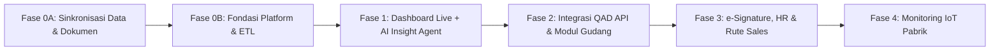

# Roadmap Pengembangan & Implementasi

Versi 0.2 · 24 Nov 2026 · Acuan: [BRD.md](BRD.md), [SRS.md](SRS.md), [ACCEPTANCE-CRITERIA.md](ACCEPTANCE-CRITERIA.md)

| Fase | Deliverable Utama | Kriteria Selesai | Estimasi Waktu |
|---|---|---|---|
| **0A. Sinkronisasi Awal** | Dokumen lengkap (22 file), perbaikan skrip data dummy, profiling data `sales.csv`. | Seluruh dokumen dan data acuan sinkron 100%. | 1 minggu |
| **0B. Fondasi Platform** | Monorepo, Docker Compose dev, skema PostgreSQL (Alembic), ETL CSV/Excel, SSO Auth, Logging. | `sales.csv`, `stock.csv`, `budget.csv` terimpor idempoten & tervalidasi. | 3–4 minggu |
| **1. Dashboard + Agent** | 3 view dashboard (Brand Manager, Head of Sales, Head of Region) + AI Insight Agent Teams (07.00 WIB). | Kriteria lolos [ACCEPTANCE-CRITERIA.md](ACCEPTANCE-CRITERIA.md) §2.2 & §2.3. | 4–6 minggu |
| **2. QAD API & Gudang** | Konektor REST QAD, alur WMS ringan berbasis FEFO, stock opname, bot Q&A Teams. | Rekonsiliasi angka vs QAD deviasi ≤ 0,5%. | 6–8 minggu |
| **3. Aplikasi Internal** | e-Signature dokumen (SHA-256 + SSO), modul HR (cuti & absensi GPS foto), PWA Rute Sales offline. | UAT seluruh modul operasional lulus. | 8–10 minggu |
| **4. IoT Pabrik** | Broker EMQX, TimescaleDB, dashboard kondisi mesin real-time, alert mesin macet < 2 menit, OEE. | Alert terkirim ke Teams < 2 menit, UAT pabrik lulus. | 6–8 minggu |
| **Lanjutan** | Ekspansi pabrik baru domestik, model peramalan permintaan (*demand forecasting*), sertifikasi PSrE. | Kebutuhan bisnis lanjutan disetujui. | Bertahap |
