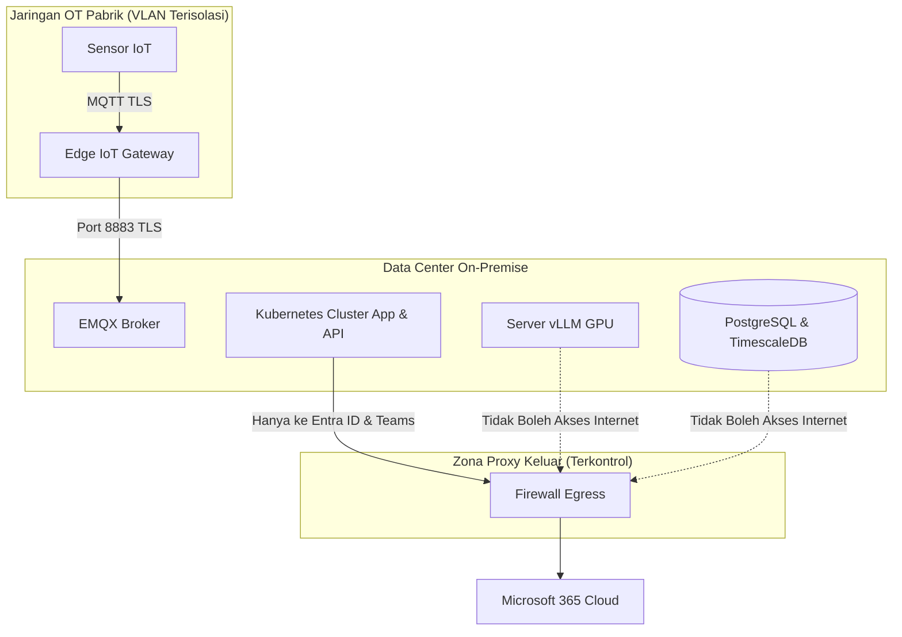

# SECURITY — Kebijakan Keamanan Sistem & Kepatuhan Data
## Platform Digital Operasional Kacang Dua Kelinci

| Item | Nilai |
|---|---|
| Versi | 0.1 (Draft) |
| Tanggal | 24 Nov 2026 |
| Status | Menunggu review stakeholder |
| Acuan | [SRS.md](SRS.md), [ARCHITECTURE.md](ARCHITECTURE.md), [DECISIONS.md](DECISIONS.md) |

---

## 1. Model Ancaman Sistem (*Threat Model STRIDE Ringkas*)

| Kategori Ancaman | Risiko Potensial | Tindakan Mitigasi yang Diterapkan |
|---|---|---|
| **Spoofing (Pemalsuan Identitas)** | Pengguna memalsukan identitas untuk menandatangani dokumen e-sign atau melihat data. | Autentikasi tunggal (SSO) wajib via Microsoft Entra ID dengan OpenID Connect dan PKCE. |
| **Tampering (Manipulasi Data)** | Perubahan angka omzet pada transaksi atau modifikasi berkas PDF yang sudah disetujui. | Hash dokumen SHA-256 tersimpan terpisah di database; audit trail append-only; proteksi write-once MinIO. |
| **Repudiation (Penyangkalan)** | Penandatangan menyangkal telah menyetujui transaksi pengadaan barang. | Perekaman jejak audit lengkap (User ID SSO, timestamp NTP tersinkronisasi, IP address, user-agent). |
| **Information Disclosure (Kebocoran Data)** | Manajer cabang melihat data omzet atau formula produksi cabang lain. | Penerapan Row-Level Security (RLS) di database PostgreSQL berdasarkan `app.user_scope`. |
| **Denial of Service (DoS)** | Lonjakan lalu lintas sensor atau query laporan berat melumpuhkan database analitik. | Partisi tabel bulanan, rate limiting API, pemisahan database analitik dari database operasional. |
| **Elevation of Privilege (Eskalasi Hak)** | Salesman memodifikasi batasan wilayah kunjungan untuk memalsukan kehadiran. | Otorisasi berbasis peran (RBAC) di sisi server API; token claims divalidasi setiap request. |

---

## 2. Matriks Otorisasi Berbasis Peran (*RBAC Matrix*)

| Peran (*Role*) | Akses Dashboard | Ingest / ETL | Persetujuan e-Sign | Modul Gudang | Modul HR | Modul Rute | IoT Pabrik |
|---|:---:|:---:|:---:|:---:|:---:|:---:|:---:|
| `admin` | Penuh | Penuh | Kelola Semua | Penuh | Penuh | Penuh | Penuh |
| `it_ops` | Read | Penuh | Audit Only | Read | Read | Read | Monitoring |
| `head_sales` | Nasional | Read Only | Approver | Read Only | Read Tim | Monitoring | Read Only |
| `head_region` | Wilayah Sendiri | - | Approver | Read Depo | Read Tim | Monitoring | - |
| `brand_manager` | Brand Sendiri | - | Approver | - | - | - | - |
| `branch_manager`| Cabang Sendiri | - | Approver | Pengawasan | Read Tim | Pengawasan | - |
| `warehouse` | - | - | - | Transaksi | - | - | - |
| `hr` | - | - | - | - | Kelola HR | - | - |
| `salesman` | - | - | - | - | Presensi | Input Rute | - |
| `factory_supervisor` | - | - | - | - | Presensi | - | Kelola IoT |

---

## 3. Segmentasi Jaringan On-Premise & Kendali Egress

- **Aturan Egress:** Seluruh server komputasi, database, dan AI dilarang mengakses internet umum. Akses keluar hanya diizinkan untuk endpoint resmi Microsoft 365 (`login.microsoftonline.com`, `graph.microsoft.com`) melalui forward proxy korporat.

---

## 4. Kepatuhan Pelindungan Data Pribadi (UU No. 27/2022 - UU PDP)
1. **Minimisasi Data:** Data presensi karyawan hanya menyimpan foto wajah saat check-in dan titik koordinat radius kerja, tanpa merekam riwayat pelacakan lokasi kontinu 24 jam.
2. **Larangan PII pada AI:** Data yang dikirimkan ke model vLLM hanya berupa angka agregat bisnis. Nama karyawan, NIK, nomor telepon, dan data pribadi lainnya dilarang masuk ke prompt model bahasa.
3. **Enkripsi Data:** Data saat transit wajib menggunakan TLS 1.2+ atau TLS 1.3. Seluruh volume penyimpanan database dan dokumen MinIO dienkripsi pada media penyimpanan (*AES-256 at-rest*).
