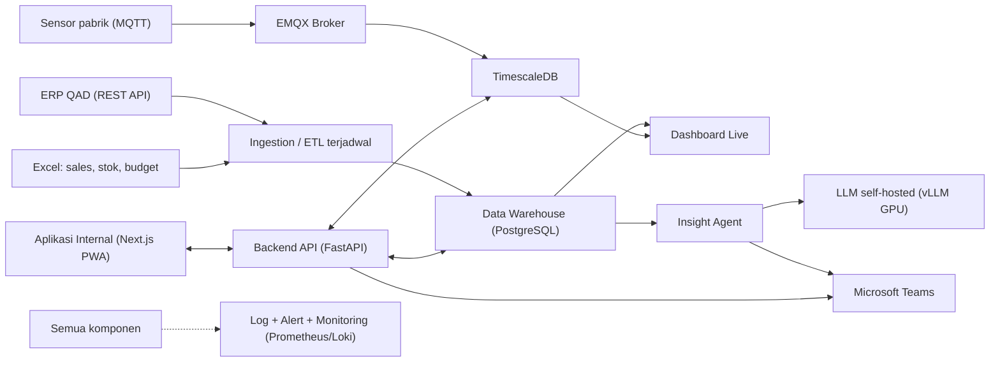
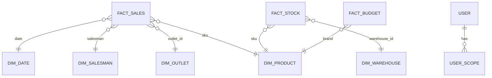
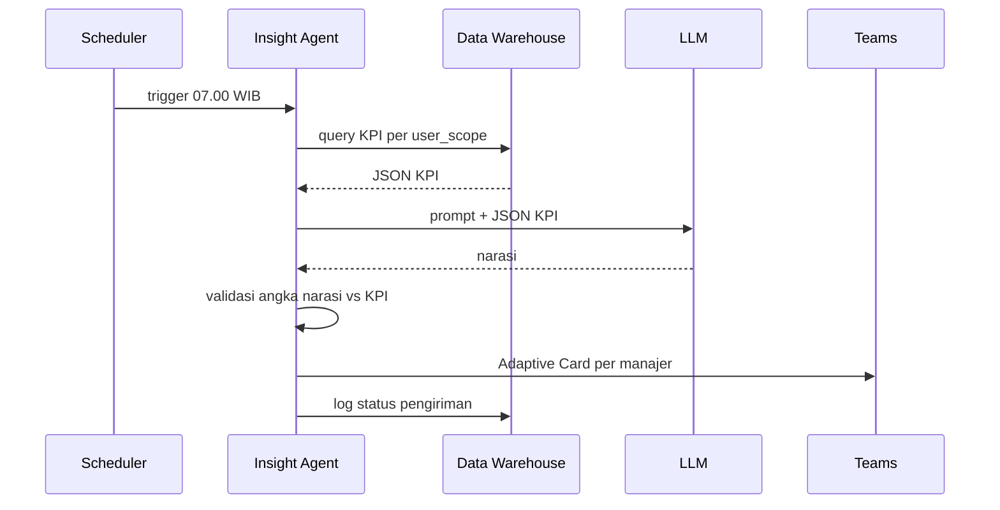

# SRS — Platform Digital Operasional Kacang

| Item | Nilai |
|---|---|
| Versi | 0.2 |
| Tanggal | 24 Nov 2026 |
| Acuan | [PRD.md](PRD.md) v0.2, [DECISIONS.md](DECISIONS.md) |

---

## 1. Pendahuluan
Dokumen ini menjabarkan kebutuhan fungsional, non-fungsional, data, antarmuka, dan arsitektur untuk modul yang didefinisikan di PRD: Insight Agent, Dashboard Live, Aplikasi Internal (e-Signature, Gudang, HR, Rute Sales, IoT), dan Operasional.

Konvensi ID: `FR-<modul>-<no>` fungsional, `NFR-<no>` non-fungsional. Prioritas: **M** (Must), **S** (Should), **C** (Could).

## 2. Arsitektur Usulan

Stack (on-premise, detail di [ARCHITECTURE.md](ARCHITECTURE.md) dan [DECISIONS.md](DECISIONS.md)):
- Backend: Python (FastAPI) + PostgreSQL 16; job terjadwal dengan Celery Beat / APScheduler.
- Frontend: Next.js (React) sebagai PWA, satu codebase untuk dashboard dan aplikasi internal, Bahasa Indonesia.
- Integrasi QAD: konektor REST API QAD, sinkron inkremental berbasis `last_modified`.
- Auth: Microsoft Entra ID (SSO, OIDC), RBAC + row-level security.
- Teams: Microsoft Graph API / Bot Framework, Adaptive Card (koneksi keluar via proxy perusahaan).
- IoT: MQTT (EMQX) → TimescaleDB.
- File: MinIO (S3-compatible) untuk dokumen e-signature & foto.
- Infrastruktur: Kubernetes on-premise (RKE2/k3s) atau Docker Compose untuk tahap awal; GitLab CI.
- Observability: Prometheus + Grafana + Loki, alert ke Teams.
- LLM: self-hosted (vLLM) di server GPU on-premise, berbagi kapasitas dengan analitik IoT.

## 3. Model Data Inti

`fact_sales` mengikuti `sales.csv`: `date, invoice_no, region, branch, outlet_id, outlet_name, outlet_type, salesman, brand, sku, qty_carton, price_per_carton_idr, gross_sales_idr, discount_idr, net_sales_idr`. Kunci unik: `(invoice_no, sku)`.

`fact_stock`: `date, entity_code, warehouse_id, sku, batch_no, expiry_date, qty_on_hand_carton, qty_in_transit_carton, qty_reserved_carton, min_stock_carton, cost_per_carton_idr, stock_value_idr`.
`fact_budget`: `period_month, entity_code, region, branch, brand, sku (opsional), budget_net_sales_idr, budget_qty_carton`.
`user_scope`: `user_id, role, scope_type (NATIONAL|REGION|BRANCH|BRAND), scope_value`.

## 4. Kebutuhan Fungsional

### 4.1 Ingestion & Data Warehouse (DATA)
| ID | Kebutuhan | Prio |
|---|---|---|
| FR-DATA-01 | Sistem mengimpor file CSV/Excel penjualan, stok, budget dari folder/SFTP/SharePoint terjadwal. | M |
| FR-DATA-02 | Validasi skema & aturan: `net = gross − discount`, `gross = qty × price`, tanggal valid, SKU dikenal. Baris gagal masuk tabel karantina + laporan. | M |
| FR-DATA-03 | Impor idempoten (upsert berdasarkan kunci unik). | M |
| FR-DATA-04 | Konektor QAD via REST API (read) dengan sinkron inkremental, paginasi, retry, dan rate limiting. | M |
| FR-DATA-05 | Setiap job ingest mencatat jumlah baris, durasi, status, dan memicu alert saat gagal. | M |

### 4.2 Insight Agent (AGT)
| ID | Kebutuhan | Prio |
|---|---|---|
| FR-AGT-01 | Membuat ringkasan harian (07.00 WIB) dan mingguan (Senin 07.00 WIB) per manajer sesuai `user_scope`. | M |
| FR-AGT-02 | KPI dihitung via query SQL deterministik: net sales, achievement % vs budget, DoD/WoW/MTD growth, diskon %, top/bottom 5 SKU/outlet/salesman, stok kritis (days of cover < ambang). | M |
| FR-AGT-03 | LLM menerima JSON KPI dan menulis narasi ≤ 150 kata Bahasa Indonesia; dilarang menambah angka baru. | M |
| FR-AGT-04 | Validator membandingkan setiap angka dalam narasi dengan JSON KPI; jika tidak cocok, kirim versi template tanpa narasi LLM. | M |
| FR-AGT-05 | Pengiriman sebagai Adaptive Card ke chat pribadi/channel Teams, dengan tautan ke dashboard terfilter. | M |
| FR-AGT-06 | Retry 3x dengan backoff; status pengiriman tercatat per penerima. | M |
| FR-AGT-07 | Q&A natural language di Teams dengan text-to-SQL terbatas pada view yang diizinkan dan scope pengguna. | C |

### 4.3 Dashboard Live (DASH)
| ID | Kebutuhan | Prio |
|---|---|---|
| FR-DASH-01 | View Brand Manager: sales & achievement per brand/SKU, tren harian, mix outlet type, diskon. | M |
| FR-DASH-02 | View Head of Sales: nasional, ranking region/branch/salesman, achievement vs budget. | M |
| FR-DASH-03 | View Head of Region: per branch, outlet, salesman, stok cabang, pencapaian rute. | M |
| FR-DASH-04 | Filter global (periode, region, branch, brand, SKU, outlet type, salesman) dan drill-down. | M |
| FR-DASH-05 | Row-level security berdasarkan `user_scope`. | M |
| FR-DASH-06 | Export ke Excel/CSV dari tabel yang sedang dilihat. | S |
| FR-DASH-07 | Menampilkan waktu data terakhir diperbarui. | M |

### 4.4 e-Signature (SIGN)
| ID | Kebutuhan | Prio |
|---|---|---|
| FR-SIGN-01 | Unggah PDF, tentukan penanda tangan & urutan (serial/paralel), posisi tanda tangan. | M |
| FR-SIGN-02 | Notifikasi Teams/email ke penanda tangan; tanda tangan setelah login SSO (+OTP opsional). | M |
| FR-SIGN-03 | PDF final dengan hash SHA-256, sertifikat penyelesaian, dan audit trail (siapa, kapan, IP). | M |
| FR-SIGN-04 | Tolak/kembalikan dengan alasan; pengingat otomatis; batas waktu. | S |
| FR-SIGN-05 | Integrasi PSrE tersertifikasi untuk dokumen legal (ditunda, keputusan ADR-004). | C |

### 4.5 Gudang (WH)
| ID | Kebutuhan | Prio |
|---|---|---|
| FR-WH-01 | Penerimaan barang (GR) per PO, scan barcode, batch & tanggal kedaluwarsa. | M |
| FR-WH-02 | Mutasi antar gudang/lokasi dan pengeluaran (DO) dengan FEFO. | M |
| FR-WH-03 | Stock opname dengan selisih & approval. | M |
| FR-WH-04 | Alert stok di bawah minimum dan barang mendekati kedaluwarsa. | M |
| FR-WH-05 | Sinkron transaksi ke QAD. | S |

### 4.6 HR (HR)
| ID | Kebutuhan | Prio |
|---|---|---|
| FR-HR-01 | Master data karyawan, struktur organisasi, atasan langsung. | M |
| FR-HR-02 | Pengajuan & approval cuti dengan saldo otomatis. | M |
| FR-HR-03 | Absensi masuk/pulang dengan GPS + foto, geofence lokasi kerja. | M |
| FR-HR-04 | Rekap absensi bulanan & export. | S |

### 4.7 Rute Sales (ROUTE)
| ID | Kebutuhan | Prio |
|---|---|---|
| FR-ROUTE-01 | Perencanaan rute mingguan per salesman (daftar outlet per hari). | M |
| FR-ROUTE-02 | Check-in/out outlet dengan validasi radius GPS, foto, catatan, order. | M |
| FR-ROUTE-03 | Peta rute & status kunjungan realtime untuk supervisor. | S |
| FR-ROUTE-04 | Optimasi urutan kunjungan (jarak terpendek). | C |
| FR-ROUTE-05 | Mode offline; sinkron saat online. | S |

### 4.8 IoT Pabrik (IOT)
| ID | Kebutuhan | Prio |
|---|---|---|
| FR-IOT-01 | Ingest telemetri via MQTT (suhu, kelembapan, counter, status mesin) tiap ≤ 10 detik. | M |
| FR-IOT-02 | Dashboard realtime per lini/mesin; histori 12 bulan. | M |
| FR-IOT-03 | Rule alert ambang batas & mesin offline > 2 menit, kirim ke Teams. | M |
| FR-IOT-04 | Perhitungan OEE (availability, performance, quality) per shift. | S |

### 4.9 Operasional (OPS)
| ID | Kebutuhan | Prio |
|---|---|---|
| FR-OPS-01 | Log terstruktur JSON (timestamp, service, level, request_id, user_id) terpusat, retensi 90 hari. | M |
| FR-OPS-02 | Alert ke channel Teams IT untuk: job gagal, error rate > 2%, latensi tinggi, disk/DB penuh, sensor offline. | M |
| FR-OPS-03 | Health check endpoint `/health` di setiap service + uptime monitor. | M |
| FR-OPS-04 | Audit log untuk aksi sensitif (approval, tanda tangan, perubahan stok, akses data HR). | M |
| FR-OPS-05 | Dokumentasi: README setup, arsitektur, runbook insiden, panduan pengguna per modul. | M |

## 5. Kebutuhan Non-Fungsional
| ID | Kebutuhan |
|---|---|
| NFR-01 | Dashboard memuat < 3 detik (p95) untuk rentang 3 bulan. |
| NFR-02 | Ketersediaan ≥ 99,5% jam kerja (06.00–22.00 WIB). |
| NFR-03 | Semua akses via SSO Entra ID; RBAC + least privilege. |
| NFR-04 | Enkripsi TLS 1.2+ in transit dan AES-256 at rest; secret di vault. |
| NFR-05 | Kepatuhan UU PDP: minimisasi data, retensi, hak akses data pribadi. |
| NFR-06 | Backup DB harian, RPO ≤ 24 jam, RTO ≤ 4 jam. |
| NFR-07 | UI responsif (mobile-first untuk Gudang, HR, Rute), Bahasa Indonesia. |
| NFR-08 | Skala nasional: ≥ 5.000 pengguna, ≥ 100 juta baris penjualan/tahun, ≥ 2.000 sensor lintas pabrik; scale-out horizontal. |
| NFR-09 | Data LLM: hanya agregat KPI dikirim ke LLM, tanpa data pribadi. |
| NFR-10 | Cakupan unit test logika KPI & validasi ≥ 80%; CI wajib lulus sebelum deploy. |
| NFR-11 | Indonesia saja: mata uang IDR, jadwal & tampilan waktu WIB (Asia/Jakarta), Bahasa Indonesia. |
| NFR-12 | Semua data & layanan berjalan on-premise; koneksi keluar hanya ke Microsoft 365 melalui proxy terkontrol. |

## 6. Antarmuka Eksternal
| Sistem | Metode | Arah |
|---|---|---|
| QAD | REST API (CSV/Excel untuk fase awal & budget) | Masuk (fase 2: keluar untuk Gudang) |
| Excel/SharePoint | Microsoft Graph / folder lokal terkelola | Masuk |
| Microsoft Teams | Graph API / Webhook, Adaptive Cards | Keluar (+ masuk untuk Q&A) |
| Entra ID | OIDC + PKCE | Auth |
| LLM | Internal on-premise (vLLM GPU, OpenAI-compatible REST) | Internal |
| Sensor IoT | MQTT over TLS (EMQX Broker) | Masuk |
| Peta | OpenStreetMap / Google Maps API | Keluar |

## 7. Contoh Alur Ringkasan Harian

## 8. Kriteria Penerimaan (MVP Fase 1)
1. `sales.csv` terimpor tanpa duplikasi; baris tidak valid dikarantina dan dilaporkan.
2. Tiga view dashboard tampil dengan RLS yang benar (diuji dengan 3 akun persona).
3. Ringkasan harian & mingguan terkirim ke Teams test tenant; angka cocok 100% dengan query acuan.
4. Kegagalan job memicu alert di channel IT dalam < 5 menit.
5. README dan runbook tersedia.

## 9. Pertanyaan Terbuka
Lihat PRD §10. Kamus data lengkap di [DATA-DICTIONARY.md](DATA-DICTIONARY.md).
