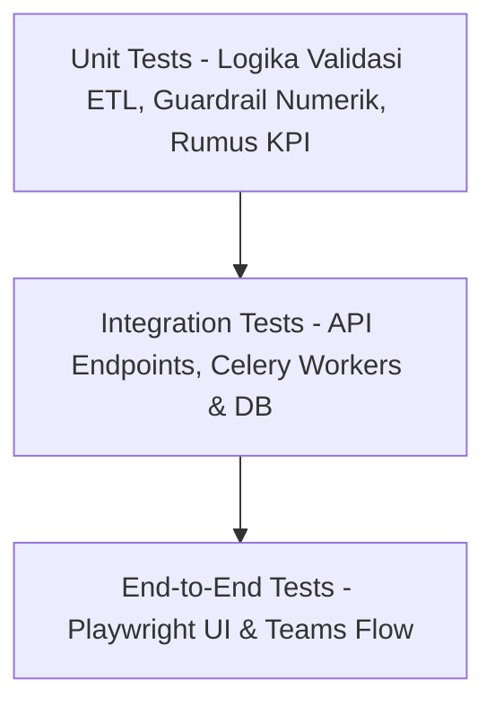

# TEST PLAN — Rencana Strategis Pengujian & Kualitas Perangkat Lunak
## Platform Digital Operasional Kacang Dua Kelinci

| Item | Nilai |
|---|---|
| Versi | 0.1 (Draft) |
| Tanggal | 24 Nov 2026 |
| Status | Menunggu review stakeholder |
| Acuan | [SRS.md](SRS.md), [ACCEPTANCE-CRITERIA.md](ACCEPTANCE-CRITERIA.md), [SPEC.md](SPEC.md) |

---

## 1. Piramida & Strategi Pengujian Sistem

- **Unit Testing (Target Coverage ≥ 80%):** Fokus pada fungsi deterministik: validasi baris transaksi, perhitungan achievement dan growth, ekstraksi angka pada teks narasi AI, dan pemetaan alias wilayah.
- **Integration Testing:** Menguji kontrak API menggunakan `pytest-asyncio` dan `httpx`, pengujian transaksi database di dalam kontainer pengujian (Testcontainers / DB rollback per test).
- **Security & RLS Testing:** Memverifikasi pembatasan baris tabel PostgreSQL untuk berbagai profil peran pengguna (`head_region`, `brand_manager`, `head_sales`).
- **End-to-End Testing:** Pengujian alur antarmuka frontend Next.js menggunakan Playwright untuk simulasi login SSO, filter dashboard, dan ekspor data.

---

## 2. Matriks Kasus Uji Kunci (*Test Cases*)

| ID Kasus Uji | Modul | Skenario Pengujian | Hasil yang Diharapkan |
|---|---|---|---|
| **TC-ETL-01** | ETL Pipeline | Memproses file `sales.csv` baseline (1.891 baris). | 1.888 baris masuk ke `dwh.fact_sales`, 3 baris duplikat ter-upsert rapi, 0 error fatal. |
| **TC-ETL-02** | ETL Pipeline | Ingesti transaksi retur `RTR900001` dengan kuantitas negatif. | Nilai dicatat sebagai tipe `RETURN` dan mengurangi total omzet bersih secara benar. |
| **TC-ETL-03** | ETL Pipeline | Ingesti baris dengan `salesman` bernilai kosong `""`. | Kolom tersimpan dengan nilai `'UNASSIGNED'` dan tercatat dalam metrik peringatan kualitas. |
| **TC-ETL-04** | ETL Pipeline | Ingesti baris dengan variasi nama `'Jabar'` dan `'JAWA BARAT'`. | Seluruhnya dinormalisasi menjadi `'Jawa Barat'` di tabel analitik. |
| **TC-RLS-01** | Keamanan Data | User Head of Region Jabar memanggil `/api/v1/dashboard/overview`. | Hanya data transaksi region Jawa Barat yang dikembalikan; query region lain ditolak (403). |
| **TC-RLS-02** | Keamanan Data | User Brand Manager Sukro memanggil `/api/v1/dashboard/overview`. | Hanya data produk brand Sukro yang dikembalikan. |
| **TC-AGT-01** | AI Guardrail | vLLM menghasilkan narasi dengan angka penjualan yang meleset Rp 100.000. | Gerbang verifikasi numerik mendeteksi selisih, menolak narasi, dan beralih ke template baku. |
| **TC-AGT-02** | AI Guardrail | Pengiriman ke Teams mengalami koneksi putus (HTTP 503). | Celery worker melakukan retry hingga 3 kali dengan backoff eksponensial. |
| **TC-IOT-01** | IoT Pabrik | Sensor mengirimkan nilai suhu 195°C (ambang batas: 180°C). | Event alert terpicu dan pesan peringatan terkirim ke kanal Teams dalam waktu < 2 menit. |
| **TC-IOT-02** | IoT Pabrik | Mesin terputus komunikasi dan mengirim sinyal MQTT LWT `OFFLINE`. | Status mesin diperbarui seketika dan tercatat pada dashboard pengawasan. |

---

## 3. Kriteria Masuk & Keluar Pengujian (*Entry & Exit Criteria*)

### 3.1 Kriteria Memulai Pengujian (*Entry Criteria*)
1. Seluruh skrip migrasi database Alembic telah dieksekusi tanpa kegagalan di lingkungan target.
2. Data master awal (`dim_entity`, `dim_region_alias`, `dim_product`, `dim_outlet`, `dim_warehouse`) telah di-seed dengan benar.
3. Seluruh dependensi layanan (PostgreSQL, Redis, MinIO, mock Teams API) berstatus *healthy*.

### 3.2 Kriteria Kelulusan Pengujian (*Exit Criteria*)
1. 100% kasus uji otomatis prioritas *Must-Have* (M) berstatus **PASS**.
2. Tidak ditemukan celah keamanan kritis (*zero critical vulnerabilities*) pada pemindaian dependensi dan kode statis.
3. Seluruh kriteria penerimaan pada [ACCEPTANCE-CRITERIA.md](ACCEPTANCE-CRITERIA.md) telah terverifikasi.
